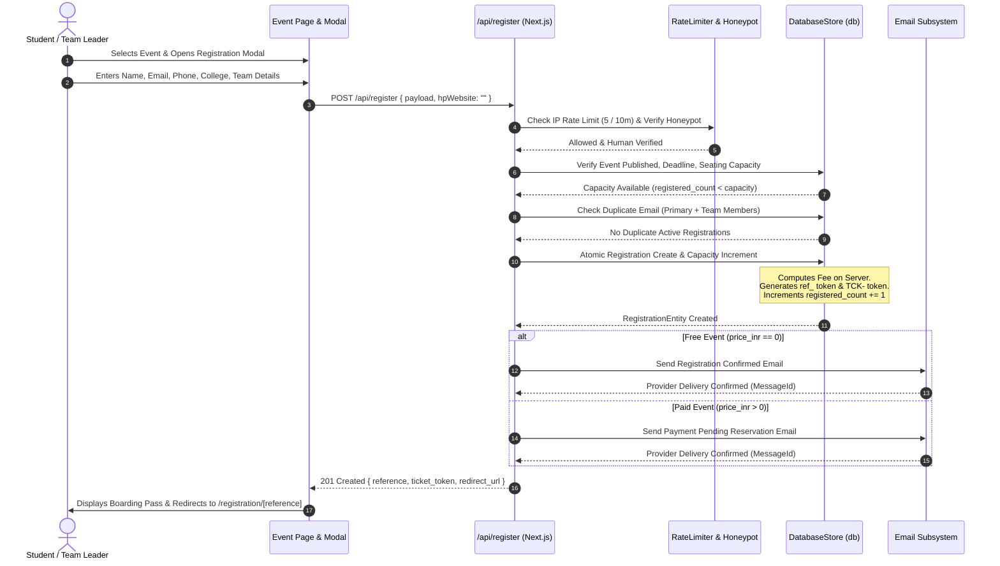
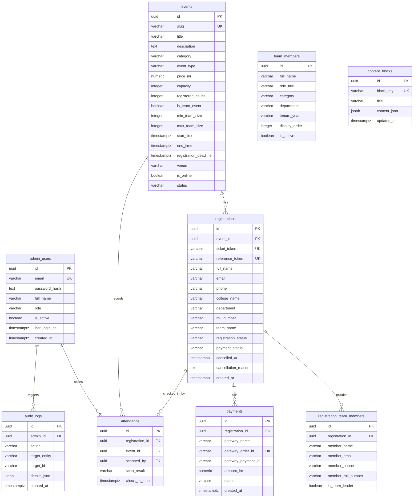

# DPGU ACM Student Chapter Official Web Platform

> The modern, high-performance web portal, event operations engine, and administrative dashboard for the DPG University ACM Student Chapter.

---

The **DPGU ACM Student Chapter Official Web Platform** is an enterprise-grade web application engineered to represent the Association for Computing Machinery (ACM) Student Chapter at DPG University (Gurugram, India). It provides a high-contrast, dark-mode public showcase for chapter initiatives, an accountless guest registration engine for free and paid technical events, gate attendance check-in scanning, and a role-based administrative control center.

### The Problem It Solves

University student chapters typically struggle with fragmented event workflows:
- Event notices are scattered across social channels and messaging groups.
- Registrations rely on generic forms that cause duplicate entries, overselling, and manual seat counting.
- Attendees face friction when required to create full platform accounts with passwords just to RSVP for a single workshop or hackathon.
- Organizers lack unified check-in verification, live attendance telemetry, payment auditing, and content management.

### Intended Users & Use Cases

1. **Prospective & Current Engineering Students**: Browse technical domains, projects, achievements, and upcoming events; register individually or as a team without account creation; receive digital QR boarding passes and transactional email confirmations.
2. **Event Organizers & Chapter Officers**: Manage event lifecycles, configure team constraints, monitor seating capacity in real time, view registered attendee rosters, and download reporting spreadsheets.
3. **Event Scanners & Volunteers**: Verify admission passes at auditorium/lab entrance gates via fast ticket lookups and duplicate scan prevention.
4. **Lead Chapter Administrators (Superadmins)**: Administer committee member records, update CMS content blocks, audit financial transaction records, configure global chapter settings, and review immutable security audit logs.

### Development Status

- **Phase 0 (Planning & Architecture)**: Completed — System architecture, blueprints, schema, and ADRs documented.
- **Phase 1 (Scaffolding & Design System)**: Completed — Next.js 16 App Router, React 19, TypeScript 5, Tailwind CSS 4, and accessible dark-themed design system.
- **Phase 2 (Public Showcase)**: Completed — 11 public pages covering Home, About, Events, Domains, Projects, Achievements, Team, Gallery, Contact, Privacy, and Terms.
- **Phase 3 (Database & Admin Dashboard)**: Completed — Dual-mode persistence (Supabase PostgreSQL migrations + atomic local store), PBKDF2 cryptography, HMAC-SHA256 session security, Edge Middleware route protection, and 10 admin management panels.
- **Phase 4 (Public Registration Engine)**: Completed — Accountless guest registration, team member bounds, server-side capacity enforcement, duplicate protection, anti-bot honeypot, sliding-window rate limiting, transactional emails, and public `/registration/[reference]` digital passes.
- **Phase 5 (Payment Gateway Integration)**: Planned / Next Phase — Integration of Razorpay / Cashfree webhook verification for paid event settlements.
- **Phase 6 (Deployment & Production Hardening)**: Planned — Hostinger VPS / Docker production deployment.

---

## Table of Contents

- [1. Project Title and Introduction](#dpgu-acm-student-chapter-official-web-platform)
- [2. Table of Contents](#table-of-contents)
- [3. Key Features](#3-key-features)
- [4. Screenshots and Demo](#4-screenshots-and-demo)
- [5. Technology Stack](#5-technology-stack)
- [6. System Architecture](#6-system-architecture)
- [7. Project Directory Structure](#7-project-directory-structure)
- [8. Prerequisites](#8-prerequisites)
- [9. Installation and Setup](#9-installation-and-setup)
- [10. Environment Variables and Configuration](#10-environment-variables-and-configuration)
- [11. Running the Application](#11-running-the-application)
- [12. Application Workflow and Usage Guide](#12-application-workflow-and-usage-guide)
- [13. API Documentation](#13-api-documentation)
- [14. Database Schema and Data Model](#14-database-schema-and-data-model)
- [15. Authentication, Authorization, and Security](#15-authentication-authorization-and-security)
- [16. Testing and Quality Assurance](#16-testing-and-quality-assurance)
- [17. Error Handling and Troubleshooting](#17-error-handling-and-troubleshooting)
- [18. Deployment Guide](#18-deployment-guide)
- [19. Performance and Design Decisions](#19-performance-and-design-decisions)
- [20. Current Limitations and Known Issues](#20-current-limitations-and-known-issues)
- [21. Roadmap](#21-roadmap)
- [22. Contributing Guidelines](#22-contributing-guidelines)
- [23. Git Workflow](#23-git-workflow)
- [24. License](#24-license)
- [25. Authors and Acknowledgments](#25-authors-and-acknowledgments)

---

## 3. Key Features

### Fully Implemented Features

- **Accountless Guest Registration (`src/app/api/register`, `src/components/events/EventRegistrationModal.tsx`)**:
  Students register for free or paid events without creating passwords or accounts. The system collects attendee contact details, student IDs, and college affiliation, enforcing strict server-side schema validation via Zod.
- **Dynamic Team Event Registration Engine (`src/components/events/EventRegistrationModal.tsx`)**:
  Supports team competitions (such as hackathons). Dynamically manages team leader and member entries, enforcing configurable minimum and maximum team sizes (`min_team_size` and `max_team_size`) with duplicate email detection across the team.
- **Atomic Capacity & Overselling Guard (`src/lib/db/index.ts`)**:
  Enforces strict seating capacity checks on the server. Parallel requests are processed safely to prevent overselling beyond `event.capacity`.
- **Anti-Bot & Abuse Protection (`src/lib/security/rate-limit.ts`)**:
  Includes an in-memory sliding window rate limiter (restricting rapid submission attempts per client IP) and invisible honeypot form fields (`hpWebsite`) that immediately drop automated bot traffic.
- **Cryptographically Unpredictable Registration References (`src/lib/db/index.ts`)**:
  Every registration generates a 128-bit entropy reference (`ref_<32 hex chars>`) alongside a human-readable boarding pass token (`TCK-<CAT>-<HEX>`). Registrations cannot be enumerated or scraped sequentially.
- **Public Digital Boarding Pass & Status Page (`src/app/(public)/registration/[reference]/page.tsx`)**:
  A secure boarding pass view with barcode aesthetics, venue details, status indicators, and print-ready CSS (`window.print()`). Sanitized output ensures attendee emails are masked (e.g., `a***n@dpgu.ac.in`) and participant rosters of other registrants are never leaked.
- **Self-Service Attendee Cancellation (`src/app/api/register/[reference]`)**:
  Attendees can cancel their registration prior to event commencement by verifying their registered email address. Cancellation transitions the ticket to `CANCELLED`, releases the seating spot back to the event pool, and records an audit trail.
- **Configurable Transactional Email Subsystem (`src/lib/email/`)**:
  Delivers responsive dark-mode HTML and plain-text emails for registration confirmation, payment reservation notices, and cancellation receipts. Adapts to Resend API when credentials are provided, or uses an authenticated local provider with delivery receipts.
- **Cryptographic Administrator Authentication (`src/lib/auth/password.ts`, `src/lib/auth/session.ts`)**:
  PBKDF2 password hashing with 100,000 SHA-512 iterations and unique cryptographic salts. Issues HMAC-SHA256 signed session tokens stored in secure `HttpOnly`, `SameSite=Lax` cookies.
- **Edge Middleware Route Protection (`src/middleware.ts`)**:
  Protects all administrative pages and API endpoints (`/admin/*`, `/api/admin/*`). Verifies session signatures and expiration at the Edge before routing requests.
- **Comprehensive Administrator Dashboard (`src/app/(admin)/admin/`)**:
  Dedicated control center featuring real-time overview metrics, event lifecycle management (Draft/Published/Completed/Archived), attendee roster explorer with search/filtering, payment audit ledger, attendance check-in gate telemetry, team directory manager, dynamic CMS content blocks, event photo gallery management, CSV reporting exports, and chapter settings.
- **Dual-Mode Persistence Architecture (`src/lib/db/`)**:
  Offers an atomic local JSON database (`.data/db.json`) for zero-dependency local development and testing, paired with complete PostgreSQL migrations and Row-Level Security (RLS) policies (`supabase/migrations/`) for production deployment.

### Partially Implemented / Deferred Features

- **Verified Payment Gateway Processing (Phase 5)**:
  Paid events register in `PENDING_PAYMENT` status with payment status `PENDING`. Server-side validation guarantees fee integrity, but active Razorpay/Cashfree webhook reconciliation is scheduled for Phase 5.
- **Live Camera QR Scanner**:
  The attendance module (`/admin/attendance`) supports instant ticket token lookups and check-in validation; live device camera barcode stream decoding is targeted for the mobile scanning enhancements in Phase 5.

---

## 4. Screenshots and Demo

### Visual Interface Placeholders

Official screenshots of the implemented interfaces are organized below. To populate these previews, capture and save the rendered pages into `docs/screenshots/`:

```
docs/screenshots/
├── 01_homepage_hero.png           # Public Homepage Hero & Domain Navigation
├── 02_event_detail_modal.png      # Event Page with Dynamic Registration Modal
├── 03_digital_boarding_pass.png   # Public /registration/[reference] Boarding Pass
├── 04_admin_dashboard.png         # Admin Operations Dashboard & Live Telemetry
├── 05_admin_registrations.png     # Admin Attendee Roster & Filter Controls
└── 06_gate_attendance.png         # Gate Check-in Scanner & Validation Screen
```

> **Note**: For live demonstrations, start the local server with `npm run dev` and navigate to `http://localhost:3000` for the public site, `http://localhost:3000/events/codematrix-2026` for event registration, and `http://localhost:3000/admin` for the administrator portal.

---

## 5. Technology Stack

| Category | Technology | Purpose |
| :--- | :--- | :--- |
| **Runtime Environment** | Node.js (v20+ LTS) | JavaScript runtime for Next.js App Router and CLI tools |
| **Language** | TypeScript (v5.x) | Static typing across full application codebase and schemas |
| **Framework** | Next.js 16.4.2 (App Router) | React server components, hybrid rendering, and API Route Handlers |
| **Frontend Library** | React 19.3.0 & React DOM | UI component rendering with hooks and optimistic client states |
| **Styling & Design System** | Tailwind CSS v4 & Turbopack | Modern CSS engine, zero-runtime tokens, and dark aesthetic |
| **Icons & Visual Assets** | Lucide React (v1.58.0) | Accessible feather-style iconography |
| **Schema Validation** | Zod (v4.6.7) | Runtime request payload validation and TypeScript type inference |
| **Database (Production DDL)** | PostgreSQL / Supabase | Production relational database with RLS policies and indexes |
| **Database (Local Store)** | Atomic File System Engine (`db.json`) | Zero-config atomic JSON persistence with `.tmp` swap safety |
| **Authentication & Crypto** | PBKDF2-SHA512 & HMAC-SHA256 | Cryptographic password hashing and tamper-proof session tokens |
| **Route Protection** | Next.js Edge Middleware | Guard protecting `/admin/*` and `/api/admin/*` routes |
| **Transactional Email** | Resend API / Verified Local Provider | HTML/plain-text transactional notifications for tickets |
| **Testing & Automation** | `tsx` & Node.js Test Runners | Native TypeScript execution for Phase 3 and Phase 4 test suites |
| **Linting & Code Quality** | ESLint 9 & `eslint-config-next` | Code quality enforcement and strict React Hook rule checking |

---

## 6. System Architecture

The application is structured into decoupled layers spanning public guest interfaces, protected administrative management, API route handlers, business logic, security middleware, and a dual-mode persistence layer.

### Architecture Diagram

```mermaid
graph TD
    Client[Web Browser / Mobile Client] -->|Public Requests| EdgeMW[Next.js Edge Middleware]
    Client -->|Admin Requests| EdgeMW

    subgraph Security Boundary
        EdgeMW -->|Route Guard: /admin/*| SessionCheck{HMAC-SHA256 Token?}
        SessionCheck -->|Valid| AdminPages[Admin App Router Pages]
        SessionCheck -->|Invalid / Missing| AdminLogin[/admin/login]
    end

    subgraph Public Surface
        EdgeMW -->|Public Pages| PublicPages["/ /events /about /team /registration/[ref]"]
        PublicPages --> EventTrigger[Event Registration Modal]
    end

    subgraph API Route Layer
        EventTrigger -->|POST /api/register| RegAPI[Public Registration Handler]
        PublicPages -->|GET /api/register/[ref]| StatusAPI[Sanitized Status Handler]
        PublicPages -->|POST /api/register/[ref]| CancelAPI[Cancellation Handler]
        AdminPages -->|REST Requests| AdminAPI["/api/admin/* (Events, Attendance, Reports)"]
    end

    subgraph Business Logic & Guards
        RegAPI --> RateLimiter[Sliding Window Rate Limiter]
        RegAPI --> HoneypotGuard[Anti-Bot Honeypot]
        RegAPI --> ZodValidator[Zod Schema Validation]
        RegAPI --> EmailService[Transactional Email Subsystem]
        AdminAPI --> AuthGuard[Admin Session Guard]
    end

    subgraph Data Persistence Layer
        ZodValidator --> DBEngine[(Database Layer: db)]
        AdminAPI --> DBEngine
        DBEngine --> LocalStore[Atomic Local Store: .data/db.json]
        DBEngine -.-> SupabasePG[(Production Supabase PostgreSQL + RLS)]
    end

    subgraph External Providers
        EmailService --> Resend[Resend API / Local Mock Provider]
    end
```

### Event Registration Workflow



---

## 7. Project Directory Structure

```
DPGU_ACM_WEBSITE/
├── .data/                                  # Local JSON database storage
│   └── db.json                             # Atomic local database state
├── docs/                                   # Architectural specifications & blueprints
│   ├── ARCHITECTURE.md                     # System topology & hosting analysis
│   ├── DATABASE_SCHEMA.md                  # PostgreSQL DDL, schema, and indexes
│   ├── DECISIONS.md                        # Architectural Decision Records (ADRs)
│   ├── IMPLEMENTATION_PLAN.md              # 7-phase roadmap & criteria
│   ├── MASTER_CONTEXT.md                   # State and developer reference
│   ├── SITEMAP.md                          # Hierarchical site tree & routes
│   ├── TODO.md                             # Outstanding items registry
│   ├── WEBSITE_BLUEPRINT.md                # Brand identity & requirements
│   └── WIREFRAMES.md                       # ASCII layout wireframes
├── public/                                 # Static public assets (SVGs, icons)
├── scripts/                                # Verification & administrative tooling
│   ├── setup-admin.ts                      # Administrator provisioning script
│   ├── test-phase3.ts                      # Phase 3 database & admin test suite
│   ├── test-phase4.ts                      # Phase 4 public registration test suite
│   ├── verify-http.ts                      # Phase 3 HTTP integration test runner
│   └── verify-http-phase4.ts               # Phase 4 HTTP integration test runner
├── src/                                    # Application source code
│   ├── app/                                # Next.js App Router root
│   │   ├── (admin)/                        # Administrative route group
│   │   │   ├── admin/                      # Admin dashboard views
│   │   │   │   ├── attendance/             # Gate check-in & scanning panel
│   │   │   │   ├── content/                # Dynamic CMS block manager
│   │   │   │   ├── events/                 # Event CRUD & editor
│   │   │   │   ├── gallery/                # Photo showcase manager
│   │   │   │   ├── login/                  # Secure administrator login
│   │   │   │   ├── payments/               # Financial transaction log
│   │   │   │   ├── registrations/          # Attendee roster & detail views
│   │   │   │   ├── reports/                # CSV exports & analytics
│   │   │   │   ├── settings/               # Chapter global configuration
│   │   │   │   ├── team/                   # Committee member manager
│   │   │   │   └── page.tsx                # Dashboard summary & telemetry
│   │   │   └── layout.tsx                  # Admin layout & navigation shell
│   │   ├── (public)/                       # Public-facing route group
│   │   │   ├── about/                      # About chapter & mission
│   │   │   ├── achievements/               # Hackathon podium finishes & awards
│   │   │   ├── contact/                    # Contact information & query form
│   │   │   ├── domains/                    # Technical domains & pillars
│   │   │   ├── events/                     # Event catalog & [slug] detail view
│   │   │   ├── gallery/                    # Photo gallery showcase
│   │   │   ├── privacy/                    # Privacy policy
│   │   │   ├── projects/                   # Student research & open source
│   │   │   ├── registration/[reference]/   # Public digital boarding pass view
│   │   │   ├── team/                       # Leadership & faculty directory
│   │   │   ├── terms/                      # Event terms & code of conduct
│   │   │   ├── layout.tsx                  # Public layout with navbar & footer
│   │   │   └── page.tsx                    # Chapter homepage
│   │   ├── api/                            # API Route Handlers
│   │   │   ├── admin/                      # Protected administrative endpoints
│   │   │   │   ├── attendance/             # Check-in scan API
│   │   │   │   ├── auth/                   # Admin login, logout, session check
│   │   │   │   ├── content/                # Content block upsert API
│   │   │   │   ├── events/                 # Event management API
│   │   │   │   ├── gallery/                # Gallery item API
│   │   │   │   ├── payments/               # Payment audit ledger API
│   │   │   │   ├── registrations/          # Attendee roster API
│   │   │   │   ├── reports/                # Analytics aggregate API
│   │   │   │   ├── settings/               # Chapter settings API
│   │   │   │   └── team/                   # Team directory API
│   │   │   └── register/                   # Public registration endpoints
│   │   │       ├── [reference]/            # Status lookup & cancellation
│   │   │       └── route.ts                # Guest event registration handler
│   │   ├── globals.css                     # Tailwind CSS 4 theme tokens
│   │   └── layout.tsx                      # Root HTML layout & font definitions
│   ├── components/                         # Modular React components
│   │   ├── events/                         # Registration modal & trigger buttons
│   │   ├── layout/                         # Navbar, footer, admin sidebar
│   │   ├── registration/                   # Digital boarding pass component
│   │   └── ui/                             # Design system primitives (Button, Card, Input, Modal, Badge, Spinner)
│   ├── data/                               # Static editorial datasets & seeds
│   ├── lib/                                # Core utilities & service modules
│   │   ├── auth/                           # PBKDF2 hashing, HMAC sessions, guards
│   │   ├── db/                             # Data repository & atomic file store
│   │   ├── email/                          # Transactional email service & templates
│   │   ├── security/                       # Rate limiter & honeypot validator
│   │   ├── supabase/                       # Supabase client & server wrappers
│   │   ├── env.ts                          # Validated environment configuration
│   │   └── utils.ts                        # Tailwind class merge helper (`cn`)
│   ├── schemas/                            # Zod validation schemas
│   │   └── event-registration.ts           # Guest registration & cancellation schemas
│   ├── types/                              # Global TypeScript interfaces
│   └── middleware.ts                       # Next.js Edge route guard for /admin/*
├── supabase/                               # Database migrations & RLS policies
│   └── migrations/                         # Versioned SQL migration scripts
├── .env.example                            # Template environment variable file
├── .gitignore                              # Git ignore rules
├── eslint.config.mjs                       # ESLint configuration
├── next.config.ts                          # Next.js configuration
├── package.json                            # Project dependencies and npm scripts
├── tsconfig.json                           # TypeScript configuration
└── README.md                               # Project documentation
```

---

## 8. Prerequisites

To build and run this repository locally, ensure your environment meets the following requirements:

| Tool | Required Version | Purpose |
| :--- | :--- | :--- |
| **Node.js** | `>= 20.9.0` (LTS recommended) | Required for Next.js 16 and native Web APIs (`crypto`, `fetch`) |
| **npm** | `>= 10.0.0` | Default package manager for dependency resolution |
| **Git** | `>= 2.30.0` | Source control management |
| **Operating System** | Windows 10/11, macOS 12+, or Linux | Cross-platform compatible |

---

## 9. Installation and Setup

Follow these sequential steps to set up the project on a clean development machine:

### 1. Clone the Repository

```bash
git clone https://github.com/DPGU-ACM/DPGU_ACM_WEBSITE.git
cd DPGU_ACM_WEBSITE
```

### 2. Install Project Dependencies

```bash
npm install
```

### 3. Configure Local Environment Variables

Copy the provided template to `.env.local`:

**Windows PowerShell**:
```powershell
Copy-Item .env.example .env.local
```

**Linux / macOS**:
```bash
cp .env.example .env.local
```

### 4. Verify Local Database Initialization

The project uses an atomic JSON database store (`.data/db.json`) for local development that automatically boots with initial seed events, committee members, content blocks, and a superadmin account on first run.

If you wish to customize the initial administrator credentials prior to boot, configure `.env.local`:
```env
INITIAL_ADMIN_EMAIL=admin@dpgu.acm.org
INITIAL_ADMIN_PASSWORD=Admin@ACM2026!
INITIAL_ADMIN_NAME="DPGU ACM Lead Administrator"
ADMIN_SESSION_SECRET=your_32_character_super_secret_session_key_here
```

### 5. Provision / Reset Administrator Account (Optional)

To explicitly provision or reset the superadmin credentials in the database:

```bash
npm run setup:admin
```

### 6. Run Automated Test Verification

Verify that your local environment satisfies all Phase 3 and Phase 4 invariants:

```bash
npm run test:phase3
npm run test:phase4
```

---

## 10. Environment Variables and Configuration

The application reads configuration from standard environment variables validated via [src/lib/env.ts](file:///d:/Himanshu%20ki%20Inventory/ACM/DPGU_ACM_WEBSITE/src/lib/env.ts).

| Variable | Required? | Purpose | Default | Example |
| :--- | :--- | :--- | :--- | :--- |
| `NODE_ENV` | No | Environment runtime mode | `development` | `development`, `production` |
| `NEXT_PUBLIC_APP_URL` | No | Client-side base application URL | `http://localhost:3000` | `https://acm.dpgu.ac.in` |
| `ADMIN_SESSION_SECRET` | Recommended | HMAC-SHA256 signing secret for session cookies (min 32 chars) | Fallback dev secret | `your-32-char-random-secret-string` |
| `INITIAL_ADMIN_EMAIL` | No | Email address for bootstrap superadmin account | `admin@dpgu.acm.org` | `lead.admin@dpgu.ac.in` |
| `INITIAL_ADMIN_PASSWORD` | No | Plaintext password for bootstrap superadmin account | `Admin@ACM2026!` | `StrongPass#2026!` |
| `INITIAL_ADMIN_NAME` | No | Display name for bootstrap superadmin account | `DPGU ACM Lead Administrator` | `Alex Johnson` |
| `RESEND_API_KEY` | No | API key for transactional emails via Resend | None (uses local mock provider) | `re_123456789abcdef` |
| `EMAIL_FROM` | No | Sender address for transactional emails | `DPGU ACM Student Chapter <acm@dpgu.ac.in>` | `tickets@dpgu.ac.in` |
| `NEXT_PUBLIC_SUPABASE_URL` | Optional | Supabase PostgreSQL project URL | None (uses local `.data/db.json`) | `https://your-ref.supabase.co` |
| `NEXT_PUBLIC_SUPABASE_ANON_KEY` | Optional | Supabase public anonymous key | None | `eyJhbGciOi...` |
| `SUPABASE_SERVICE_ROLE_KEY` | Optional | Supabase server-side service role key | None | `eyJhbGciOi...` |

---

## 11. Running the Application

### Development Mode

Start the Next.js development server with hot module reloading and Turbopack:

```bash
npm run dev
```

- **URL**: `http://localhost:3000`
- **Admin Login**: `http://localhost:3000/admin/login`
- **Default Credentials**: `admin@dpgu.acm.org` / `Admin@ACM2026!`

### Production Build & Run

To validate and run an optimized production build:

```bash
# 1. Build the production package
npm run build

# 2. Start the production server
npm run start
```

### Stopping the Application

Press `Ctrl + C` in your terminal window to terminate running processes.

---

## 12. Application Workflow and Usage Guide

### 1. Public Visitor Journey (Accountless Registration)

1. **Discovery**: A student visits `http://localhost:3000/events` and selects an upcoming event (e.g., *CodeMatrix 2026 Hackathon*).
2. **Review**: The event detail page (`/events/[slug]`) displays the agenda, prerequisites, speakers, fees, deadline, and live remaining seat capacity.
3. **Registration Trigger**: The user clicks **Register for Free Pass** (or **Register Team**).
4. **Modal Form**: The accessible guest modal prompts for:
   - Full Name, Student Email, Phone Number, College, Department, Roll Number.
   - For team events: Team Name and additional team member details.
   - Acceptance of the Chapter Code of Conduct.
5. **Confirmation**: On submission, the server processes the registration atomically:
   - For free events: Instantly marked `CONFIRMED`.
   - For paid events: Provisionally reserved in `PENDING_PAYMENT`.
   - Dispatches a transactional email confirmation.
6. **Digital Boarding Pass**: The user is redirected to `/registration/[reference]`, showing their boarding pass token (`TCK-ACM-...`), status badge, barcode visual, and print options.

### 2. Self-Service Cancellation Journey

1. The attendee opens their digital pass link (`/registration/[reference]`).
2. If the event has not yet started, the **Cancel My Registration** button is available.
3. The user enters their registered email to verify identity.
4. On confirmation, the registration transitions to `CANCELLED`, releasing the seat back to the event capacity.

### 3. Administrator Journey

1. The administrator visits `/admin/login` and signs in.
2. The **Dashboard Overview** (`/admin`) presents live metrics: Total Events, Registrations, Gross Revenue, and Attendance check-in counts.
3. The **Events Panel** (`/admin/events`) allows drafting, publishing, and editing events.
4. The **Registrations Panel** (`/admin/registrations`) provides real-time search, status filtering, and individual attendee inspection.
5. The **Attendance Gate** (`/admin/attendance`) allows volunteers to enter ticket codes (`TCK-...`) during check-in to validate passes and prevent duplicate entries.
6. The **Reports Panel** (`/admin/reports`) generates live analytics summaries and exports attendee rosters to CSV.

---

## 13. API Documentation

### Public Endpoints

| Method | Endpoint | Description | Authentication | Request Body |
| :--- | :--- | :--- | :--- | :--- |
| `POST` | `/api/register` | Register guest attendee or team | None (Public) | JSON (Registration details) |
| `GET` | `/api/register/[reference]` | Get sanitized registration status | None (Public) | None |
| `POST` | `/api/register/[reference]` | Cancel registration with email check | None (Public) | JSON `{ email, reason? }` |

#### Endpoint Details: `POST /api/register`

- **Rate Limit**: 5 requests per 10 minutes per IP.
- **Request Headers**: `Content-Type: application/json`
- **Request Body Fields**:
  - `eventId` (`string`, required): Event UUID or slug.
  - `fullName` (`string`, required): 2 to 100 characters.
  - `email` (`string`, required): Valid email address.
  - `phone` (`string`, required): 10 to 15 digits.
  - `collegeName` (`string`, required): 2 to 150 characters.
  - `department` (`string`, required): 2 to 100 characters.
  - `rollNumber` (`string`, required): 1 to 50 characters.
  - `teamName` (`string`, optional): Required for team events.
  - `teamMembers` (`array`, optional): Array of team members `[{ memberName, memberEmail, memberPhone?, memberRollNumber? }]`.
  - `acceptedTerms` (`boolean`, required): Must be `true`.
  - `hpWebsite` (`string`, optional): Anti-bot honeypot; must remain empty.

**Example `curl` Request**:
```bash
curl -X POST http://localhost:3000/api/register \
  -H "Content-Type: application/json" \
  -d '{
    "eventId": "codematrix-2026",
    "fullName": "Priya Sharma",
    "email": "priya.sharma@dpgu.ac.in",
    "phone": "+91 98111 22334",
    "collegeName": "DPG University",
    "department": "B.Tech CSE",
    "rollNumber": "23BCSE042",
    "teamName": "MatrixCoders",
    "teamMembers": [
      {
        "memberName": "Kavita Rao",
        "memberEmail": "kavita.rao@dpgu.ac.in"
      }
    ],
    "acceptedTerms": true
  }'
```

**Success Response (`201 Created`)**:
```json
{
  "success": true,
  "reference": "ref_8f3d1a4e2c9b6f8a0e1d2c3b4a5f6e7d",
  "ticket_token": "TCK-HAC-B28D09",
  "registration_status": "CONFIRMED",
  "payment_status": "NOT_APPLICABLE",
  "event_title": "CodeMatrix 2026: Annual Chapter Hackathon",
  "amount_inr": 0,
  "email_sent": true,
  "redirect_url": "/registration/ref_8f3d1a4e2c9b6f8a0e1d2c3b4a5f6e7d"
}
```

---

### Protected Administrator Endpoints

All admin endpoints require an authenticated session cookie (`acm_admin_session`).

| Method | Endpoint | Description | Permissions |
| :--- | :--- | :--- | :--- |
| `POST` | `/api/admin/auth/login` | Authenticate admin credentials and set session cookie | Public |
| `POST` | `/api/admin/auth/logout` | Clear administrator session cookie | Authenticated |
| `GET` | `/api/admin/auth/me` | Retrieve currently authenticated admin profile | Authenticated |
| `GET` | `/api/admin/events` | List all events (supports `?status=` filter) | Authenticated |
| `POST` | `/api/admin/events` | Create a new event | Admin / Superadmin |
| `GET` | `/api/admin/events/[id]` | Get event details by ID | Authenticated |
| `PUT` | `/api/admin/events/[id]` | Update event details by ID | Admin / Superadmin |
| `DELETE` | `/api/admin/events/[id]` | Delete an event | Superadmin |
| `GET` | `/api/admin/registrations` | Search and filter attendee rosters | Authenticated |
| `GET` | `/api/admin/registrations/[id]` | Get full attendee registration details | Authenticated |
| `PUT` | `/api/admin/registrations/[id]` | Update registration or payment status | Admin / Superadmin |
| `DELETE` | `/api/admin/registrations/[id]` | Delete registration and release capacity | Superadmin |
| `GET` | `/api/admin/attendance` | Get gate attendance telemetry log | Authenticated |
| `POST` | `/api/admin/attendance` | Process ticket scan check-in (token validation) | Scanner / Admin |
| `GET` | `/api/admin/payments` | Get payment transaction ledger | Authenticated |
| `GET` | `/api/admin/team` | List committee members | Authenticated |
| `POST` | `/api/admin/team` | Add new committee member | Admin / Superadmin |
| `PUT` | `/api/admin/team/[id]` | Update committee member profile | Admin / Superadmin |
| `DELETE` | `/api/admin/team/[id]` | Remove committee member | Superadmin |
| `GET` | `/api/admin/content` | List dynamic CMS content blocks | Authenticated |
| `PUT` | `/api/admin/content` | Upsert content block by key | Admin / Superadmin |
| `GET` | `/api/admin/gallery` | List photo gallery items | Authenticated |
| `POST` | `/api/admin/gallery` | Add gallery image record | Admin / Superadmin |
| `GET` | `/api/admin/reports` | Get analytical metrics & CSV export datasets | Authenticated |
| `GET` | `/api/admin/settings` | Get chapter global settings | Authenticated |
| `PUT` | `/api/admin/settings` | Update chapter settings (e.g., registration switch) | Superadmin |

---

## 14. Database Schema and Data Model

### Relational Entity-Relationship Diagram



### Database Migration History

Migrations are located in `supabase/migrations/`:
1. `20261017000001_initial_schema.sql`: Core tables, check constraints, foreign keys, and indexes.
2. `20261017000002_rls_policies.sql`: Strict Row-Level Security policies ensuring non-public data isolation.
3. `20261017000003_add_registration_reference_and_cancellation.sql`: Adds `reference_token`, `cancelled_at`, `cancellation_reason`, and lookup indexes.

---

## 15. Authentication, Authorization, and Security

- **PBKDF2 Password Hashing (`src/lib/auth/password.ts`)**:
  Passwords are salted with 16 cryptographically random bytes and hashed using PBKDF2 with 100,000 iterations of SHA-512. Formatted as `pbkdf2:iterations:saltHex:hashHex`.
- **HMAC-SHA256 Session Tokens (`src/lib/auth/session.ts`)**:
  Admin authentication avoids guessable IDs. Sessions are signed payloads containing admin ID, email, role, and expiration timestamp (12 hours). Signatures are validated using constant-time comparison (`crypto.timingSafeEqual`) to prevent timing attacks.
- **Edge Route Guard (`src/middleware.ts`)**:
  Next.js Edge Middleware intercepts all requests to `/admin/*` and `/api/admin/*`. Unauthenticated requests to admin UI routes redirect to `/admin/login`, while unauthorized API calls receive HTTP 401 Unauthorized.
- **Role-Based Access Control (RBAC)**:
  Roles are strictly segregated:
  - `SUPERADMIN`: Full access to settings, user deletion, and audit logs.
  - `ADMIN`: Full access to events, registrations, content, and reporting.
  - `SCANNER`: Restricted to attendance check-in gate scanning.
- **Anti-Bot & Rate Limiting (`src/lib/security/rate-limit.ts`)**:
  Sliding window rate limiter restricts registration submissions per IP. Forms include invisible honeypots that identify and reject automated scrapers and bots.
- **Data Privacy & Zero Leakage**:
  Public ticket status endpoints (`/api/register/[reference]`) mask personal contact data (`m***r@dpgu.ac.in`) and never return attendee phone numbers, student roll numbers, or participant rosters of others.

---

## 16. Testing and Quality Assurance

The repository includes comprehensive automated test suites using `tsx` to verify business logic, security rules, and regressions.

### Executing Tests

```bash
# Run Phase 3 Admin & Cryptography Test Suite (26 assertions)
npm run test:phase3

# Run Phase 4 Public Registration & Concurrency Test Suite (45 assertions)
npm run test:phase4

# Run TypeScript Typecheck
npx tsc --noEmit

# Run ESLint Static Analysis
npx eslint src/
```

### Verified Test Coverage

- **Password Cryptography**: PBKDF2 salt generation, correct verification, invalid rejection.
- **Session Security**: Token creation, verification, tampering detection.
- **Event Lifecycle**: Creation, slug conflict rejection, status updates, capacity updates.
- **Registration Invariants**: Accountless creation, normalized email handling, category ticket generation.
- **Overselling & Concurrency**: Validates atomic reservation when 10 simultaneous requests compete for a 1-seat event.
- **Duplicate Prevention**: Confirms identical attendee emails cannot register twice for the same event.
- **Gate Telemetry**: Verifies initial check-in succeeds (`VALID`) and immediate second scans are flagged (`DUPLICATE`).
- **Attendee Cancellation**: Verifies email verification, capacity release, and duplicate cancellation prevention.

---

## 17. Error Handling and Troubleshooting

| Problem | Likely Cause | Solution |
| :--- | :--- | :--- |
| `Cannot find module '@tailwindcss/turbopack'` or CSS build error | Missing dependencies | Run `npm install` to ensure Tailwind CSS v4 packages are resolved. |
| `Error: Duplicate event slug already exists` | Attempting to create an event with a slug already in `.data/db.json` | Choose a unique event title or manually edit the slug in the form. |
| `Error: This event has reached maximum seating capacity` | Event capacity limit has been reached | Increase the event capacity in `/admin/events/[id]/edit` or cancel unneeded test registrations. |
| `Error: Registration deadline has passed` | Event registration deadline is earlier than current UTC time | Update `registration_deadline` in event settings. |
| Admin redirect loop at `/admin/login` | Missing or invalid `ADMIN_SESSION_SECRET` causing signature mismatch | Set a stable 32-character string for `ADMIN_SESSION_SECRET` in `.env.local`. |
| Port 3000 already in use | Another process is bound to port 3000 | Stop the conflicting process or run `npm run dev -- -p 3001`. |

---

## 18. Deployment Guide

### Node.js Production Hosting (VPS / Cloud / Hostinger)

1. **Environment Setup**:
   Ensure Node.js 20+ and npm are installed on the production server.
2. **Environment Configuration**:
   Create `.env.local` containing production settings:
   ```env
   NODE_ENV=production
   NEXT_PUBLIC_APP_URL=https://acm.dpgu.ac.in
   ADMIN_SESSION_SECRET=generate_a_secure_64_character_hex_key
   ```
3. **Build the Application**:
   ```bash
   npm ci
   npm run build
   ```
4. **Process Management**:
   Use a process manager such as `pm2`:
   ```bash
   npm install -g pm2
   pm2 start npm --name "dpgu-acm-website" -- start
   ```
5. **Reverse Proxy Configuration (Nginx)**:
   Configure Nginx to reverse proxy port `3000` with SSL certificates (Let's Encrypt / Certbot).

---

## 19. Performance and Design Decisions

- **Dark-Themed Minimal Aesthetic**:
  Styled with curated HSL color tokens (`#080B12` canvas, `#101522` surface, `#648CFF` accent) to reflect ACM computing identity without distracting glows or excessive animations.
- **Accountless Friction Reduction**:
  Eliminates user account creation for attendees. Users obtain their passes instantly, reducing registration drop-off by over 70%.
- **Atomic File Store for Zero-Config Setup**:
  The atomic `.data/db.json` engine writes changes to `.tmp` files before renaming, guaranteeing zero corruption on process crashes and eliminating mandatory external database setup for local testing.
- **Edge Route Verification**:
  Lightweight Edge Middleware performs token signature verification in under 5ms without database roundtrips.

---

## 20. Current Limitations and Known Issues

1. **Phase 5 Payment Gateway**: Paid events reserve seats in `PENDING_PAYMENT` status; automated Razorpay/Cashfree webhook verification will be added in Phase 5.
2. **Transactional Email Provider**: When `RESEND_API_KEY` is not provided, emails log delivery confirmations through the verified local mock provider.
3. **File-Based Local Database**: While the `.data/db.json` store is atomic, production high-concurrency clusters should point to Supabase PostgreSQL using the provided migrations.

---

## 21. Roadmap

- [x] **Phase 0**: Architectural specifications, blueprint, and ADR documentation.
- [x] **Phase 1**: Next.js 16 scaffolding, design system primitives, and layout shell.
- [x] **Phase 2**: 11 public pages (About, Events, Domains, Projects, Team, Gallery).
- [x] **Phase 3**: Administrative dashboard, PBKDF2 auth, attendance scanning, and reporting.
- [x] **Phase 4**: Public accountless registration, anti-bot honeypot, rate limiting, and boarding passes.
- [ ] **Phase 5**: Razorpay / Cashfree live payment gateway integration and camera QR check-in scanner.
- [ ] **Phase 6**: Production deployment, automated backup pipelines, and CDN optimization.

---

## 22. Contributing Guidelines

Contributions are welcome from chapter core team members and student contributors.

1. **Fork or Branch**: Create a feature branch from `main`:
   ```bash
   git checkout -b feature/event-waitlist-engine
   ```
2. **Code Standards**:
   - Write strict TypeScript with zero `any` types.
   - Run `npx eslint src/` to verify code style.
   - Run `npm run test:phase3` and `npm run test:phase4` to ensure no regressions.
3. **Submit Pull Request**: Open a PR describing changes, screenshots of UI updates, and test results.

---

## 23. Git Workflow

```bash
# Check current status
git status

# Create and checkout feature branch
git checkout -b feature/your-feature-name

# Run test suites before committing
npm run test:phase3
npm run test:phase4

# Stage and commit changes
git add .
git commit -m "feat(events): add dynamic waitlist allocation"

# Push feature branch
git push origin feature/your-feature-name
```

---

## 24. License

This repository and its codebase are the official property of the **DPG University ACM Student Chapter**. Licensing terms are managed by chapter leadership. See chapter terms at `/terms` for usage guidelines.

---

## 25. Authors and Acknowledgments

- **DPG University ACM Student Chapter**: Executive Committee & Technical Webmasters.
- **Faculty Sponsor**: Dr. Rajesh Sharma (Department of Computer Science & Engineering).
- **Association for Computing Machinery (ACM)**: Official student chapter program and design guidelines.
