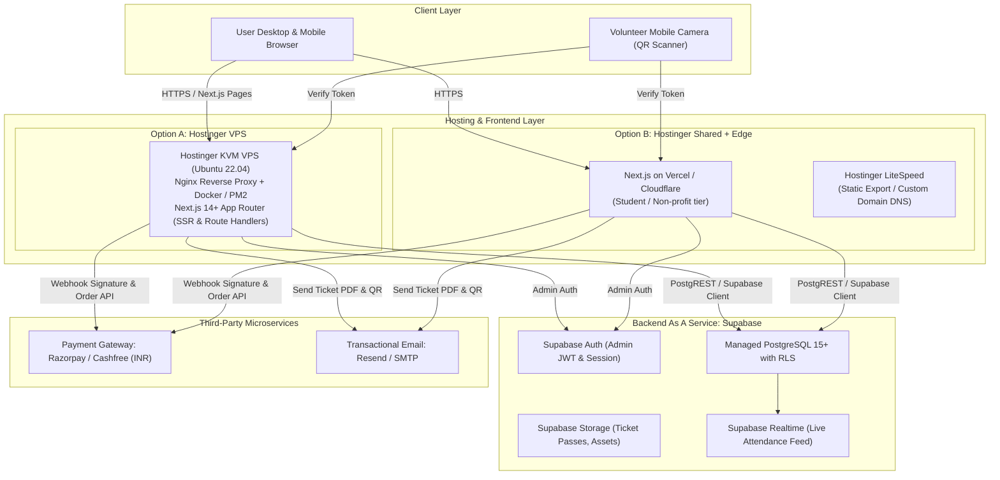
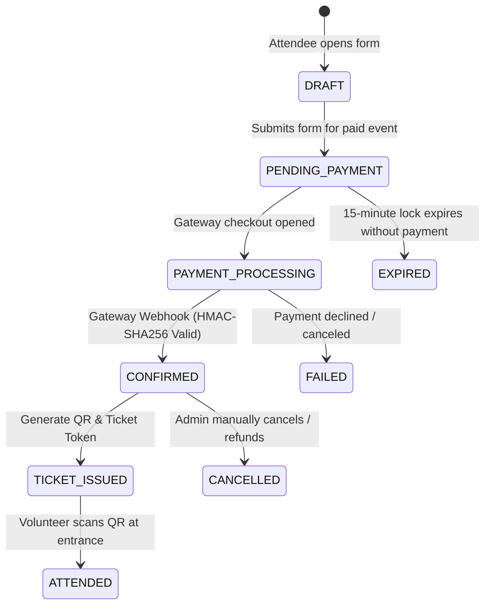

# DPGU ACM Student Chapter — System Architecture & Hosting Blueprint

## 1. Executive Hosting Analysis & Hostinger Compatibility

### 1.1 Hostinger Hosting Plan Capability Matrix

A major architectural constraint for the DPGU ACM Student Chapter is that hosting is provided through Hostinger, but the exact plan tier and runtime capabilities have not yet been verified.

| Hostinger Plan Tier | Runtime Environment | Node.js Support | PostgreSQL Support | Next.js SSR Compatibility | Recommended Role in Architecture |
| :--- | :--- | :--- | :--- | :--- | :--- |
| **Single / Premium Web Hosting** | CloudLinux / LiteSpeed Shared | None (PHP 7.4-8.3 only) | ❌ No (MySQL / MariaDB only) | ❌ Incompatible with SSR (Static export only) | LiteSpeed static asset CDN only (if coupled with Supabase BaaS) |
| **Business / Cloud Startup Hosting** | CloudLinux / LiteSpeed WebADC | ⚠️ Limited (Node.js Selector via Passenger) | ❌ No (MySQL / MariaDB only) | ⚠️ Fragile (idling sleep, RAM caps, cold restarts) | Possible for lightweight Node with external Supabase Postgres |
| **Hostinger KVM VPS (KVM 1 / 2 / 4)** | Full Root Ubuntu 22.04/24.04 LTS | ✅ Full (Node 20+ LTS, Docker, PM2) | ✅ Full (Self-hosted Postgres or external Supabase) | ✅ 100% Native Fullstack SSR | Optimal for unified Next.js + Docker deployment |

### 1.2 Verification Checklist for Chapter Administrators

The chapter lead must execute the following 5-minute audit in Hostinger hPanel to confirm the operational tier:

1. **Log in to Hostinger hPanel**: Navigate to `https://hpanel.hostinger.com`.
2. **Inspect Hosting Dashboard**:
   - Check the plan title displayed under the main domain (e.g., *Premium Web Hosting*, *Business Web Hosting*, *Cloud Startup*, or *VPS KVM 2*).
3. **Verify Node.js Capabilities**:
   - Under the left sidebar menu, look for **Advanced** -> **Node.js**.
   - If present: Note the supported Node.js versions (e.g., Node 18, 20) and whether "Application root" and "Startup file" configuration fields exist.
   - If absent: The plan is standard shared PHP/MySQL hosting.
4. **Verify Database Engines**:
   - Navigate to **Databases** -> **Management**.
   - Note if only **MySQL Databases** are present, or if PostgreSQL is offered (Hostinger shared plans never offer PostgreSQL).
5. **Check SSH & Terminal Access**:
   - Navigate to **Advanced** -> **SSH Access**. Check if SSH is enabled with key authentication or terminal console.

---

## 2. Recommended Hosting-Compatible Architecture

To ensure the project succeeds regardless of whether Hostinger provides a basic shared web hosting plan or a full KVM VPS, we adopt a **Decoupled Modern Cloud Architecture with Supabase as the Data Engine**.



### 2.1 Why This Architecture is Optimal
1. **Solves the PostgreSQL Bottleneck**: Hostinger shared hosting does NOT provide PostgreSQL. By utilizing managed PostgreSQL via Supabase (or external cloud Postgres), we guarantee full relational integrity, JSONB support, and Row Level Security (RLS) regardless of the Hostinger tier.
2. **Zero Invalidation Risk**: If Hostinger is a VPS, Next.js runs natively as a Dockerized Node.js service on the VPS connecting to PostgreSQL. If Hostinger is shared hosting, the Next.js application deploys to Vercel (free for student/open-source non-profits) mapped to the chapter's custom domain on Hostinger DNS, or the static frontend builds directly into Hostinger's LiteSpeed root while APIs invoke Supabase Edge Functions.
3. **High Security for Single Admin**: Supabase provides enterprise-grade authentication with cryptographically signed JWT cookies, session revocation, and Row Level Security (RLS).
4. **Frictionless Public Registration**: Public guests make direct REST/Server Action calls to `/api/register`. The backend validates event seat capacity in a serial database transaction, preventing race conditions.

---

## 3. Core Component & Directory Architecture

The Next.js 14+ App Router architecture is structured cleanly into functional modular layers:

```
dpgu-acm-website/
├── src/
│   ├── app/                               # Next.js App Router
│   │   ├── (public)/                      # Public Layout Group
│   │   │   ├── page.tsx                   # Homepage (/)
│   │   │   ├── about/page.tsx             # About Chapter
│   │   │   ├── events/
│   │   │   │   ├── page.tsx               # Events Catalog
│   │   │   │   └── [slug]/page.tsx        # Event Detail & Registration Modal
│   │   │   ├── tickets/
│   │   │   │   └── [ticketId]/page.tsx    # Digital Pass View
│   │   │   ├── projects/page.tsx          # Student Projects Showcase
│   │   │   ├── achievements/page.tsx      # Hall of Fame
│   │   │   ├── team/page.tsx              # Executive Committee
│   │   │   ├── contact/page.tsx           # Contact & Membership Inquiries
│   │   │   └── layout.tsx                 # Public Header, Navigation, Footer
│   │   ├── (admin)/                       # Protected Admin Layout Group
│   │   │   ├── admin/
│   │   │   │   ├── login/page.tsx         # Admin Login (No sidebar)
│   │   │   │   ├── page.tsx               # Dashboard KPI Overview
│   │   │   │   ├── events/page.tsx        # Event Manager
│   │   │   │   ├── registrations/page.tsx # Registrations & Payment Ledger
│   │   │   │   ├── scanner/page.tsx       # Live In-Browser Camera QR Scanner
│   │   │   │   ├── content/page.tsx       # CMS for Team, Projects, Awards
│   │   │   │   ├── reports/page.tsx       # CSV Exports & Financial Reports
│   │   │   │   └── settings/page.tsx      # System Configuration
│   │   │   └── layout.tsx                 # Admin Sidebar, Auth Guard, Header
│   │   ├── api/                           # API Route Handlers
│   │   │   ├── register/route.ts          # Public Event Registration API
│   │   │   ├── payments/
│   │   │   │   ├── create-order/route.ts  # Payment Gateway Order Creator
│   │   │   │   └── webhook/route.ts       # Payment Webhook Handler (HMAC)
│   │   │   ├── tickets/
│   │   │   │   ├── [ticketId]/route.ts    # Ticket Pass Data API
│   │   │   │   └── verify/route.ts        # Admin QR Check-in Endpoint
│   │   │   ├── contact/route.ts           # Contact Form Submission Handler
│   │   │   └── admin/                     # Protected Admin Endpoints
│   │   ├── globals.css                    # Tailwind CSS & Design Tokens
│   │   └── layout.tsx                     # Root HTML, Fonts & Analytics
│   ├── components/                        # UI Component Library
│   │   ├── ui/                            # Atoms: Buttons, Inputs, Badges, Modals
│   │   ├── public/                        # Molecules: EventCard, ProjectCard, TeamCard
│   │   ├── forms/                         # Organisms: GuestRegistrationForm, ContactForm
│   │   ├── tickets/                       # DigitalPass, QRCodeRenderer, PrintButton
│   │   └── admin/                         # MetricCard, AttendeeTable, CameraScanner
│   ├── lib/                               # Core Libraries & Utilities
│   │   ├── supabase/                      # Supabase Client & Server Handlers
│   │   │   ├── client.ts                  # Public Client
│   │   │   ├── server.ts                  # Server Component Client
│   │   │   └── admin.ts                   # Service Role Client (Bypasses RLS)
│   │   ├── payments/                      # Razorpay / Cashfree SDK Client
│   │   ├── email/                         # Resend / Nodemailer Email Dispatcher
│   │   ├── qrcode/                        # QR Code Payload Signer & Parser
│   │   └── validations/                   # Zod Schemas for Registration, Event Forms
│   └── types/                             # TypeScript Definitions & Database Types
```

---

## 4. Payment Gateway Webhook & State Machine Pipeline

To prevent financial mismatches, missed tickets, or duplicate entries, the payment processing pipeline uses an **idempotent state machine**:



### 4.1 Payment Security Protocols
1. **Cryptographic Signature Verification**:
   - The `/api/payments/webhook` endpoint inspects the `x-razorpay-signature` (or gateway equivalent) header.
   - Computes: `HMAC-SHA256(order_id + "|" + payment_id, WEBHOOK_SECRET)`.
   - If mismatch: HTTP `400 Bad Signature` immediately; execution aborts.
2. **Idempotency Guarantee**:
   - Webhook deliveries are logged in the `payments` table with the unique gateway `payment_id`.
   - If a duplicate webhook arrives for an already processed `payment_id`, the system returns HTTP `200 OK` without duplicating ticket issuance or email dispatches.
3. **Atomic Capacity Reservation**:
   - When a user initiates a registration, a 15-minute temporary reservation lock prevents event overbooking during checkout.

---

## 5. Security, Privacy, & Governance

### 5.1 Single Administrator Authentication
- **Mechanism**: The single administrator account is authenticated via Supabase Auth (or Iron-Session with Argon2id password hashing).
- **Session Tokens**: JWT stored in an `HttpOnly`, `SameSite=Lax`, `Secure` cookie.
- **Route Protection**: Next.js Edge Middleware (`middleware.ts`) inspects the session token on all `/admin/*` routes (except `/admin/login`). Unauthenticated requests are immediately redirected with a return URL parameter.

### 5.2 Row-Level Security (RLS) Policy Architecture
- By default, all tables have Row Level Security enabled (`ALTER TABLE ... ENABLE ROW LEVEL SECURITY;`).
- Public visitors have `SELECT` access only on published events, past projects, achievements, and team members.
- Public visitors have `INSERT` access to `registrations` only via validated backend server actions or strict RLS constraints.
- Sensitive financial tables (`payments`), attendance logs, and draft events are restricted strictly to the `service_role` (backend) or authenticated admin role.

### 5.3 Attendee Privacy & DPDP Act Compliance
- **Data Minimization**: Only essential registration fields are collected: Name, Email, Phone, College, Roll Number. No sensitive personal data (e.g. government ID, physical address) is requested.
- **Zero Account Footprint**: Attendees are not forced to store passwords or manage user profiles, eliminating credentials database leak risks for event participants.
- **No Third-Party Analytics Trackers**: No Google Analytics or Facebook Pixel scripts that sell or track student browsing data.

---

## 6. Backup & Disaster Recovery Strategy

1. **Continuous PostgreSQL Backups**:
   - Managed via Supabase with Point-in-Time Recovery (PITR) and automated daily snapshots.
2. **Weekly Air-Gapped SQL Dumps**:
   - An automated GitHub Action or cron job executes `pg_dump` weekly, encrypts the dump with AES-256, and uploads it to secure cloud storage.
3. **Pre-Event Attendance Snapshots**:
   - 2 hours prior to every major physical chapter event, the chapter admin exports the complete attendee roster to an offline encrypted CSV spreadsheet.
   - In the event of venue internet outage or server failure, gatekeepers can perform manual check-in using the offline roster.
