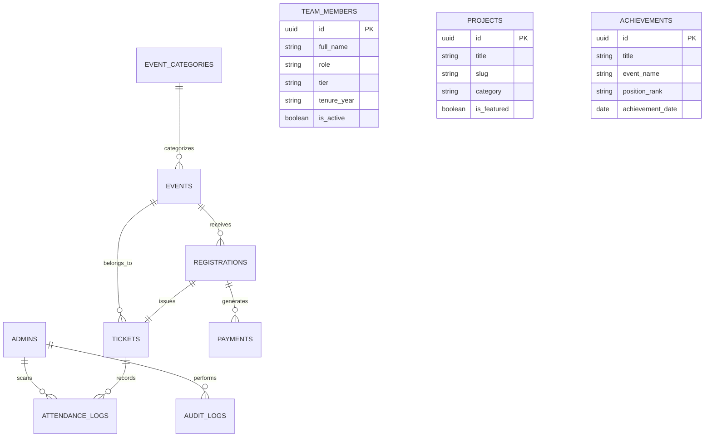

# DPGU ACM Student Chapter — Database Schema Specification

This document defines the complete PostgreSQL / Supabase relational database schema, integrity constraints, indexes, Row Level Security (RLS) policies, and executable SQL DDL migration.

---

## 1. Entity-Relationship (ER) Diagram



---

## 2. Table Specifications & Schema Dictionary

### 2.1 Table: `admins`
Stores the chapter administrative user(s). The system starts with a single master administrator account.

| Column | Data Type | Constraints | Description |
| :--- | :--- | :--- | :--- |
| `id` | `UUID` | `PRIMARY KEY DEFAULT gen_random_uuid()` | Unique administrator identifier |
| `email` | `VARCHAR(255)` | `UNIQUE NOT NULL` | Master admin login email |
| `password_hash` | `TEXT` | `NOT NULL` | Argon2id / bcrypt password hash |
| `full_name` | `VARCHAR(150)` | `NOT NULL` | Display name of the chapter officer |
| `role` | `VARCHAR(50)` | `DEFAULT 'SUPERADMIN'` | Security role (`SUPERADMIN`, `SCANNER`) |
| `is_active` | `BOOLEAN` | `DEFAULT TRUE` | Account active status flag |
| `last_login_at` | `TIMESTAMPTZ`| `NULL` | Timestamp of most recent authentication |
| `created_at` | `TIMESTAMPTZ`| `DEFAULT NOW()` | Record creation timestamp |
| `updated_at` | `TIMESTAMPTZ`| `DEFAULT NOW()` | Record update timestamp |

---

### 2.2 Table: `event_categories`
Lookup table for organizing events (e.g., Workshops, Hackathons, Tech Talks, Coding Contests).

| Column | Data Type | Constraints | Description |
| :--- | :--- | :--- | :--- |
| `id` | `UUID` | `PRIMARY KEY DEFAULT gen_random_uuid()` | Unique category identifier |
| `slug` | `VARCHAR(60)` | `UNIQUE NOT NULL` | URL-safe slug (`workshops`, `hackathons`) |
| `name` | `VARCHAR(100)` | `NOT NULL` | Display title |
| `description` | `TEXT` | `NULL` | Optional category description |
| `created_at` | `TIMESTAMPTZ`| `DEFAULT NOW()` | Timestamp |

---

### 2.3 Table: `events`
Core event catalogue records representing free and paid workshops, seminars, and hackathons.

| Column | Data Type | Constraints | Description |
| :--- | :--- | :--- | :--- |
| `id` | `UUID` | `PRIMARY KEY DEFAULT gen_random_uuid()` | Unique event identifier |
| `slug` | `VARCHAR(120)` | `UNIQUE NOT NULL` | URL routing slug (`codematrix-2026`) |
| `title` | `VARCHAR(255)` | `NOT NULL` | Full event title |
| `subtitle` | `VARCHAR(300)` | `NULL` | Secondary summary hook |
| `description` | `TEXT` | `NOT NULL` | Full markdown/HTML event details & agenda |
| `category_id` | `UUID` | `REFERENCES event_categories(id)` | Associated category |
| `banner_url` | `TEXT` | `NULL` | Header cover image asset URL |
| `event_type` | `VARCHAR(20)` | `CHECK (event_type IN ('FREE', 'PAID'))` | Ticket pricing mode |
| `price_inr` | `NUMERIC(10,2)`| `DEFAULT 0.00 CHECK (price_inr >= 0)` | Ticket fee in Indian Rupees |
| `capacity` | `INTEGER` | `NOT NULL CHECK (capacity > 0)` | Maximum seats/admissions allowed |
| `registered_count`| `INTEGER` | `DEFAULT 0 CHECK (registered_count >= 0)` | Cached count of confirmed attendees |
| `start_time` | `TIMESTAMPTZ`| `NOT NULL` | Event start date and time |
| `end_time` | `TIMESTAMPTZ`| `NOT NULL CHECK (end_time > start_time)` | Event conclusion date and time |
| `venue` | `VARCHAR(255)` | `NOT NULL` | Physical room or "Virtual" |
| `is_online` | `BOOLEAN` | `DEFAULT FALSE` | True if event is remote/hybrid |
| `meeting_link` | `TEXT` | `NULL` | Zoom/Meet URL (revealed on ticket) |
| `status` | `VARCHAR(30)` | `CHECK (status IN ('DRAFT', 'PUBLISHED', 'COMPLETED', 'CANCELLED'))` | Current lifecycle state |
| `created_at` | `TIMESTAMPTZ`| `DEFAULT NOW()` | Timestamp |
| `updated_at` | `TIMESTAMPTZ`| `DEFAULT NOW()` | Timestamp |

---

### 2.4 Table: `registrations`
Stores guest registrations. No user account is required; guest email is the communication key.

| Column | Data Type | Constraints | Description |
| :--- | :--- | :--- | :--- |
| `id` | `UUID` | `PRIMARY KEY DEFAULT gen_random_uuid()` | Unique registration record identifier |
| `event_id` | `UUID` | `REFERENCES events(id) ON DELETE CASCADE`| Target event |
| `full_name` | `VARCHAR(150)` | `NOT NULL` | Attendee legal or preferred name |
| `email` | `VARCHAR(255)` | `NOT NULL` | Delivery email address |
| `phone` | `VARCHAR(20)` | `NOT NULL` | WhatsApp / mobile contact number |
| `college_name` | `VARCHAR(200)` | `NOT NULL` | University / College institution |
| `department` | `VARCHAR(100)` | `NOT NULL` | Department / Branch (e.g. CSE, IT) |
| `roll_number` | `VARCHAR(50)` | `NOT NULL` | Student University Roll No / ID |
| `registration_status` | `VARCHAR(30)` | `CHECK (registration_status IN ('PENDING_PAYMENT', 'CONFIRMED', 'CANCELLED', 'EXPIRED'))` | Registration state |
| `payment_status` | `VARCHAR(30)` | `CHECK (payment_status IN ('NOT_APPLICABLE', 'PENDING', 'SUCCESS', 'FAILED'))` | Gateway payment status |
| `created_at` | `TIMESTAMPTZ`| `DEFAULT NOW()` | Submission timestamp |
| `updated_at` | `TIMESTAMPTZ`| `DEFAULT NOW()` | Timestamp |

**Integrity Constraint**:
- Unique constraint: `UNIQUE (event_id, LOWER(email))` ensures that no guest can register twice for the same event with the same email.

---

### 2.5 Table: `tickets`
Digital pass generated upon confirmed registration. Houses the cryptographic QR token.

| Column | Data Type | Constraints | Description |
| :--- | :--- | :--- | :--- |
| `id` | `UUID` | `PRIMARY KEY DEFAULT gen_random_uuid()` | Unique ticket record ID |
| `registration_id` | `UUID` | `UNIQUE REFERENCES registrations(id) ON DELETE CASCADE` | 1-to-1 link to registration |
| `event_id` | `UUID` | `REFERENCES events(id) ON DELETE CASCADE`| Fast reference to event |
| `ticket_token` | `VARCHAR(80)` | `UNIQUE NOT NULL` | High-entropy token (`DPGU-2026-X8F29A`) |
| `qr_payload` | `TEXT` | `NOT NULL` | Encoded HMAC verification payload |
| `is_checked_in` | `BOOLEAN` | `DEFAULT FALSE` | True if attendee has entered event |
| `checked_in_at` | `TIMESTAMPTZ`| `NULL` | Entrance timestamp |
| `checked_in_by` | `UUID` | `REFERENCES admins(id) NULL` | Admin who performed scan |
| `created_at` | `TIMESTAMPTZ`| `DEFAULT NOW()` | Ticket issuance timestamp |

---

### 2.6 Table: `payments`
Financial transaction ledger logging payment gateway charges, order IDs, and webhook confirmations.

| Column | Data Type | Constraints | Description |
| :--- | :--- | :--- | :--- |
| `id` | `UUID` | `PRIMARY KEY DEFAULT gen_random_uuid()` | Unique payment record ID |
| `registration_id` | `UUID` | `REFERENCES registrations(id) ON DELETE CASCADE` | Associated registration |
| `gateway_name` | `VARCHAR(50)` | `NOT NULL` | `RAZORPAY`, `CASHFREE`, or `STRIPE` |
| `gateway_order_id`| `VARCHAR(100)` | `UNIQUE NOT NULL` | Gateway Order Reference |
| `gateway_payment_id`| `VARCHAR(100)`| `NULL` | Gateway Payment Transaction ID |
| `gateway_signature`| `TEXT` | `NULL` | HMAC signature for audit validation |
| `amount_inr` | `NUMERIC(10,2)`| `NOT NULL CHECK (amount_inr >= 0)` | Charge amount in INR |
| `currency` | `VARCHAR(10)` | `DEFAULT 'INR'` | Currency denomination |
| `status` | `VARCHAR(30)` | `CHECK (status IN ('PENDING', 'SUCCESS', 'FAILED', 'REFUNDED'))` | Transaction status |
| `raw_webhook_payload`| `JSONB` | `NULL` | Full raw JSON for reconciliation |
| `created_at` | `TIMESTAMPTZ`| `DEFAULT NOW()` | Timestamp |
| `updated_at` | `TIMESTAMPTZ`| `DEFAULT NOW()` | Timestamp |

---

### 2.7 Table: `attendance_logs`
High-fidelity audit log tracking every QR scan attempt (successful, duplicate, or invalid).

| Column | Data Type | Constraints | Description |
| :--- | :--- | :--- | :--- |
| `id` | `UUID` | `PRIMARY KEY DEFAULT gen_random_uuid()` | Log ID |
| `ticket_id` | `UUID` | `REFERENCES tickets(id) NULL` | Ticket scanned |
| `scanned_by` | `UUID` | `REFERENCES admins(id) NULL` | Scanning admin ID |
| `scan_result` | `VARCHAR(30)` | `CHECK (scan_result IN ('VALID', 'DUPLICATE', 'INVALID'))` | Result of scan |
| `ip_address` | `VARCHAR(45)` | `NULL` | Scanner IP address |
| `user_agent` | `TEXT` | `NULL` | Scanner browser agent |
| `scanned_at` | `TIMESTAMPTZ`| `DEFAULT NOW()` | Scan timestamp |

---

### 2.8 Table: `team_members` (CMS)
Roster of current and past chapter officers and faculty sponsors.

| Column | Data Type | Constraints | Description |
| :--- | :--- | :--- | :--- |
| `id` | `UUID` | `PRIMARY KEY DEFAULT gen_random_uuid()` | Member ID |
| `full_name` | `VARCHAR(150)` | `NOT NULL` | Officer name |
| `role` | `VARCHAR(100)` | `NOT NULL` | Office held (e.g. Chapter Chair) |
| `tier` | `VARCHAR(30)` | `CHECK (tier IN ('FACULTY', 'EXECUTIVE', 'LEAD', 'CORE'))` | Organizational tier |
| `bio` | `TEXT` | `NULL` | Short biography |
| `photo_url` | `TEXT` | `NULL` | Profile portrait asset URL |
| `linkedin_url` | `TEXT` | `NULL` | LinkedIn profile |
| `github_url` | `TEXT` | `NULL` | GitHub profile |
| `tenure_year` | `VARCHAR(20)` | `NOT NULL` | e.g. `2026-2027` |
| `display_order` | `INTEGER` | `DEFAULT 0` | Sort priority |
| `is_active` | `BOOLEAN` | `DEFAULT TRUE` | Active committee status |
| `created_at` | `TIMESTAMPTZ`| `DEFAULT NOW()` | Timestamp |

---

### 2.9 Table: `projects` (CMS)
Student engineering projects showcased on the public portal.

| Column | Data Type | Constraints | Description |
| :--- | :--- | :--- | :--- |
| `id` | `UUID` | `PRIMARY KEY DEFAULT gen_random_uuid()` | Project ID |
| `slug` | `VARCHAR(120)` | `UNIQUE NOT NULL` | URL slug |
| `title` | `VARCHAR(200)` | `NOT NULL` | Project title |
| `summary` | `VARCHAR(350)` | `NOT NULL` | Short summary |
| `description` | `TEXT` | `NOT NULL` | Markdown project breakdown |
| `category` | `VARCHAR(50)` | `NOT NULL` | e.g. `AI/ML`, `Web`, `IoT`, `Systems` |
| `tags` | `TEXT[]` | `DEFAULT '{}'` | Array of tech tags (`["Next.js", "Rust"]`) |
| `demo_url` | `TEXT` | `NULL` | Live demo link |
| `repo_url` | `TEXT` | `NULL` | GitHub repository link |
| `image_url` | `TEXT` | `NULL` | Project screenshot URL |
| `is_featured` | `BOOLEAN` | `DEFAULT FALSE` | Spotlight on homepage |
| `created_at` | `TIMESTAMPTZ`| `DEFAULT NOW()` | Timestamp |

---

### 2.10 Table: `achievements` (CMS)
Hall of fame records documenting competition victories, hackathon awards, and research.

| Column | Data Type | Constraints | Description |
| :--- | :--- | :--- | :--- |
| `id` | `UUID` | `PRIMARY KEY DEFAULT gen_random_uuid()` | Achievement ID |
| `title` | `VARCHAR(255)` | `NOT NULL` | Award title (e.g. `1st Place - SIH 2026`) |
| `event_name` | `VARCHAR(200)` | `NOT NULL` | Competition or host organization |
| `position_rank` | `VARCHAR(50)` | `NOT NULL` | `Winner`, `1st Runner Up`, etc. |
| `achievement_date`| `DATE` | `NOT NULL` | Date achieved |
| `description` | `TEXT` | `NULL` | Description and team members involved |
| `photo_url` | `TEXT` | `NULL` | Ceremony / trophy photo URL |
| `created_at` | `TIMESTAMPTZ`| `DEFAULT NOW()` | Timestamp |

---

### 2.11 Table: `audit_logs`
Security audit trail recording administrative actions.

| Column | Data Type | Constraints | Description |
| :--- | :--- | :--- | :--- |
| `id` | `UUID` | `PRIMARY KEY DEFAULT gen_random_uuid()` | Audit log ID |
| `admin_id` | `UUID` | `REFERENCES admins(id)` | Admin who took the action |
| `action` | `VARCHAR(100)` | `NOT NULL` | e.g. `EVENT_CREATED`, `EXPORT_CSV` |
| `target_entity` | `VARCHAR(50)` | `NOT NULL` | `events`, `registrations`, etc. |
| `target_id` | `TEXT` | `NULL` | Primary key of modified entity |
| `details` | `JSONB` | `NULL` | Change diff or metadata |
| `ip_address` | `VARCHAR(45)` | `NULL` | IP address |
| `created_at` | `TIMESTAMPTZ`| `DEFAULT NOW()` | Event timestamp |

---

## 3. Indexes & Performance Optimization

```sql
-- Events Query Indexes
CREATE INDEX idx_events_status_start ON events (status, start_time DESC);
CREATE INDEX idx_events_slug ON events (slug);

-- Registrations & Duplicate Protection
CREATE INDEX idx_registrations_event_status ON registrations (event_id, registration_status);
CREATE UNIQUE INDEX idx_unique_event_email ON registrations (event_id, LOWER(email));

-- Ticket Lookup & QR Verification Indexes
CREATE UNIQUE INDEX idx_tickets_token ON tickets (ticket_token);
CREATE INDEX idx_tickets_event ON tickets (event_id);
CREATE INDEX idx_tickets_checked_in ON tickets (event_id, is_checked_in);

-- Payments Reconciliation
CREATE UNIQUE INDEX idx_payments_order ON payments (gateway_order_id);
CREATE INDEX idx_payments_status ON payments (status);

-- Team & Projects Ordering
CREATE INDEX idx_team_display_order ON team_members (is_active, display_order ASC);
CREATE INDEX idx_projects_featured ON projects (is_featured, created_at DESC);
```

---

## 4. Row Level Security (RLS) Policies

```sql
-- Enable RLS across all tables
ALTER TABLE admins ENABLE ROW LEVEL SECURITY;
ALTER TABLE events ENABLE ROW LEVEL SECURITY;
ALTER TABLE registrations ENABLE ROW LEVEL SECURITY;
ALTER TABLE tickets ENABLE ROW LEVEL SECURITY;
ALTER TABLE payments ENABLE ROW LEVEL SECURITY;
ALTER TABLE attendance_logs ENABLE ROW LEVEL SECURITY;
ALTER TABLE team_members ENABLE ROW LEVEL SECURITY;
ALTER TABLE projects ENABLE ROW LEVEL SECURITY;
ALTER TABLE achievements ENABLE ROW LEVEL SECURITY;
ALTER TABLE audit_logs ENABLE ROW LEVEL SECURITY;

-- 1. Public Read Policies
CREATE POLICY "Public can view published events" 
ON events FOR SELECT USING (status = 'PUBLISHED' OR status = 'COMPLETED');

CREATE POLICY "Public can view active team members" 
ON team_members FOR SELECT USING (is_active = TRUE);

CREATE POLICY "Public can view projects" 
ON projects FOR SELECT USING (TRUE);

CREATE POLICY "Public can view achievements" 
ON achievements FOR SELECT USING (TRUE);

-- 2. Public Ticket Token Lookup Policy
CREATE POLICY "Public can view their own ticket by token" 
ON tickets FOR SELECT USING (TRUE);

-- 3. Admin Full Access Policy (Authenticated Admin Role)
CREATE POLICY "Admins have full access to all tables" 
ON events FOR ALL TO authenticated USING (TRUE);

CREATE POLICY "Admins have full access to registrations" 
ON registrations FOR ALL TO authenticated USING (TRUE);

CREATE POLICY "Admins have full access to tickets" 
ON tickets FOR ALL TO authenticated USING (TRUE);

CREATE POLICY "Admins have full access to payments" 
ON payments FOR ALL TO authenticated USING (TRUE);

CREATE POLICY "Admins have full access to attendance_logs" 
ON attendance_logs FOR ALL TO authenticated USING (TRUE);
```

---

## 5. Complete SQL DDL Migration Script

```sql
-- DPGU ACM Student Chapter Database Migration DDL
-- Compatible with PostgreSQL 14+ / Supabase

CREATE EXTENSION IF NOT EXISTS "pgcrypto";

-- 1. Admins Table
CREATE TABLE IF NOT EXISTS admins (
    id UUID PRIMARY KEY DEFAULT gen_random_uuid(),
    email VARCHAR(255) UNIQUE NOT NULL,
    password_hash TEXT NOT NULL,
    full_name VARCHAR(150) NOT NULL,
    role VARCHAR(50) DEFAULT 'SUPERADMIN',
    is_active BOOLEAN DEFAULT TRUE,
    last_login_at TIMESTAMPTZ,
    created_at TIMESTAMPTZ DEFAULT NOW(),
    updated_at TIMESTAMPTZ DEFAULT NOW()
);

-- 2. Event Categories Table
CREATE TABLE IF NOT EXISTS event_categories (
    id UUID PRIMARY KEY DEFAULT gen_random_uuid(),
    slug VARCHAR(60) UNIQUE NOT NULL,
    name VARCHAR(100) NOT NULL,
    description TEXT,
    created_at TIMESTAMPTZ DEFAULT NOW()
);

-- 3. Events Table
CREATE TABLE IF NOT EXISTS events (
    id UUID PRIMARY KEY DEFAULT gen_random_uuid(),
    slug VARCHAR(120) UNIQUE NOT NULL,
    title VARCHAR(255) NOT NULL,
    subtitle VARCHAR(300),
    description TEXT NOT NULL,
    category_id UUID REFERENCES event_categories(id) ON DELETE SET NULL,
    banner_url TEXT,
    event_type VARCHAR(20) NOT NULL CHECK (event_type IN ('FREE', 'PAID')),
    price_inr NUMERIC(10,2) DEFAULT 0.00 CHECK (price_inr >= 0),
    capacity INTEGER NOT NULL CHECK (capacity > 0),
    registered_count INTEGER DEFAULT 0 CHECK (registered_count >= 0),
    start_time TIMESTAMPTZ NOT NULL,
    end_time TIMESTAMPTZ NOT NULL CHECK (end_time > start_time),
    venue VARCHAR(255) NOT NULL,
    is_online BOOLEAN DEFAULT FALSE,
    meeting_link TEXT,
    status VARCHAR(30) DEFAULT 'DRAFT' CHECK (status IN ('DRAFT', 'PUBLISHED', 'COMPLETED', 'CANCELLED')),
    created_at TIMESTAMPTZ DEFAULT NOW(),
    updated_at TIMESTAMPTZ DEFAULT NOW()
);

-- 4. Registrations Table (Guest Checkout)
CREATE TABLE IF NOT EXISTS registrations (
    id UUID PRIMARY KEY DEFAULT gen_random_uuid(),
    event_id UUID NOT NULL REFERENCES events(id) ON DELETE CASCADE,
    full_name VARCHAR(150) NOT NULL,
    email VARCHAR(255) NOT NULL,
    phone VARCHAR(20) NOT NULL,
    college_name VARCHAR(200) NOT NULL,
    department VARCHAR(100) NOT NULL,
    roll_number VARCHAR(50) NOT NULL,
    registration_status VARCHAR(30) DEFAULT 'PENDING_PAYMENT' 
        CHECK (registration_status IN ('PENDING_PAYMENT', 'CONFIRMED', 'CANCELLED', 'EXPIRED')),
    payment_status VARCHAR(30) DEFAULT 'NOT_APPLICABLE' 
        CHECK (payment_status IN ('NOT_APPLICABLE', 'PENDING', 'SUCCESS', 'FAILED')),
    created_at TIMESTAMPTZ DEFAULT NOW(),
    updated_at TIMESTAMPTZ DEFAULT NOW()
);

-- 5. Tickets Table
CREATE TABLE IF NOT EXISTS tickets (
    id UUID PRIMARY KEY DEFAULT gen_random_uuid(),
    registration_id UUID UNIQUE NOT NULL REFERENCES registrations(id) ON DELETE CASCADE,
    event_id UUID NOT NULL REFERENCES events(id) ON DELETE CASCADE,
    ticket_token VARCHAR(80) UNIQUE NOT NULL,
    qr_payload TEXT NOT NULL,
    is_checked_in BOOLEAN DEFAULT FALSE,
    checked_in_at TIMESTAMPTZ,
    checked_in_by UUID REFERENCES admins(id) ON DELETE SET NULL,
    created_at TIMESTAMPTZ DEFAULT NOW()
);

-- 6. Payments Table
CREATE TABLE IF NOT EXISTS payments (
    id UUID PRIMARY KEY DEFAULT gen_random_uuid(),
    registration_id UUID NOT NULL REFERENCES registrations(id) ON DELETE CASCADE,
    gateway_name VARCHAR(50) NOT NULL,
    gateway_order_id VARCHAR(100) UNIQUE NOT NULL,
    gateway_payment_id VARCHAR(100),
    gateway_signature TEXT,
    amount_inr NUMERIC(10,2) NOT NULL CHECK (amount_inr >= 0),
    currency VARCHAR(10) DEFAULT 'INR',
    status VARCHAR(30) DEFAULT 'PENDING' CHECK (status IN ('PENDING', 'SUCCESS', 'FAILED', 'REFUNDED')),
    raw_webhook_payload JSONB,
    created_at TIMESTAMPTZ DEFAULT NOW(),
    updated_at TIMESTAMPTZ DEFAULT NOW()
);

-- 7. Attendance Logs Table
CREATE TABLE IF NOT EXISTS attendance_logs (
    id UUID PRIMARY KEY DEFAULT gen_random_uuid(),
    ticket_id UUID REFERENCES tickets(id) ON DELETE CASCADE,
    scanned_by UUID REFERENCES admins(id) ON DELETE SET NULL,
    scan_result VARCHAR(30) NOT NULL CHECK (scan_result IN ('VALID', 'DUPLICATE', 'INVALID')),
    ip_address VARCHAR(45),
    user_agent TEXT,
    scanned_at TIMESTAMPTZ DEFAULT NOW()
);

-- 8. Team Members Table (CMS)
CREATE TABLE IF NOT EXISTS team_members (
    id UUID PRIMARY KEY DEFAULT gen_random_uuid(),
    full_name VARCHAR(150) NOT NULL,
    role VARCHAR(100) NOT NULL,
    tier VARCHAR(30) NOT NULL CHECK (tier IN ('FACULTY', 'EXECUTIVE', 'LEAD', 'CORE')),
    bio TEXT,
    photo_url TEXT,
    linkedin_url TEXT,
    github_url TEXT,
    tenure_year VARCHAR(20) NOT NULL,
    display_order INTEGER DEFAULT 0,
    is_active BOOLEAN DEFAULT TRUE,
    created_at TIMESTAMPTZ DEFAULT NOW()
);

-- 9. Projects Table (CMS)
CREATE TABLE IF NOT EXISTS projects (
    id UUID PRIMARY KEY DEFAULT gen_random_uuid(),
    slug VARCHAR(120) UNIQUE NOT NULL,
    title VARCHAR(200) NOT NULL,
    summary VARCHAR(350) NOT NULL,
    description TEXT NOT NULL,
    category VARCHAR(50) NOT NULL,
    tags TEXT[] DEFAULT '{}',
    demo_url TEXT,
    repo_url TEXT,
    image_url TEXT,
    is_featured BOOLEAN DEFAULT FALSE,
    created_at TIMESTAMPTZ DEFAULT NOW()
);

-- 10. Achievements Table (CMS)
CREATE TABLE IF NOT EXISTS achievements (
    id UUID PRIMARY KEY DEFAULT gen_random_uuid(),
    title VARCHAR(255) NOT NULL,
    event_name VARCHAR(200) NOT NULL,
    position_rank VARCHAR(50) NOT NULL,
    achievement_date DATE NOT NULL,
    description TEXT,
    photo_url TEXT,
    created_at TIMESTAMPTZ DEFAULT NOW()
);

-- 11. Audit Logs Table
CREATE TABLE IF NOT EXISTS audit_logs (
    id UUID PRIMARY KEY DEFAULT gen_random_uuid(),
    admin_id UUID REFERENCES admins(id) ON DELETE SET NULL,
    action VARCHAR(100) NOT NULL,
    target_entity VARCHAR(50) NOT NULL,
    target_id TEXT,
    details JSONB,
    ip_address VARCHAR(45),
    created_at TIMESTAMPTZ DEFAULT NOW()
);
```
