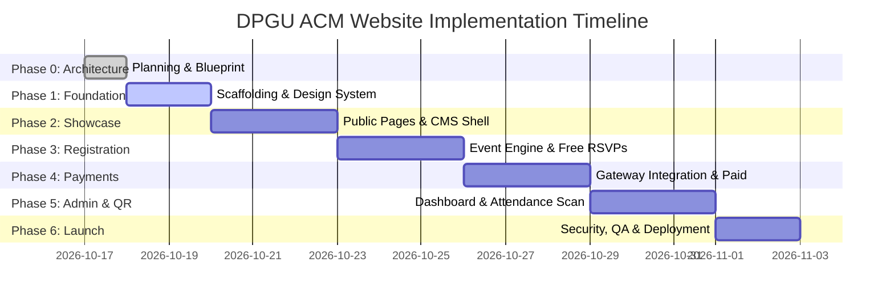

# DPGU ACM Student Chapter — Implementation Plan & Phase Roadmap

This document outlines the phased delivery roadmap, milestone objectives, technical deliverables, and **acceptance criteria for every implementation phase** of the DPGU ACM Student Chapter platform.

---

## 1. Project Phase Roadmap Summary

---

## 2. Phase-by-Phase Specifications & Acceptance Criteria

### Phase 0: Planning, Requirements Analysis, & Architecture
- **Objective**: Establish complete project blueprints, database schema, design specifications, wireframes, hosting compatibility analysis, and ADRs before writing production code.
- **Deliverables**:
  - `README.md`
  - `docs/WEBSITE_BLUEPRINT.md`
  - `docs/SITEMAP.md`
  - `docs/WIREFRAMES.md`
  - `docs/ARCHITECTURE.md`
  - `docs/DATABASE_SCHEMA.md`
  - `docs/DECISIONS.md`
  - `docs/IMPLEMENTATION_PLAN.md`
  - `docs/TODO.md`
- **Acceptance Criteria**:
  1. [x] Complete workspace inspection conducted; no unrelated files altered.
  2. [x] Hostinger hosting capability matrix documented with step-by-step verification instructions.
  3. [x] Missing decisions and unresolved questions identified and cataloged without inventing chapter data.
  4. [x] Complete sitemap and page-by-page ASCII wireframes created.
  5. [x] Complete PostgreSQL database schema created with relationships, indexes, constraints, RLS policies, and SQL DDL.
  6. [x] Hosting-compatible decoupled architecture recommended (Next.js + Supabase Postgres).
  7. [x] Comprehensive implementation plan and acceptance criteria produced for all subsequent phases.

---

### Phase 1: Project Scaffolding, Core Infrastructure, & Design System
- **Objective**: Initialize the Next.js 14+ TypeScript project, configure Tailwind CSS design tokens, establish Supabase connection utilities, and build reusable UI primitive components.
- **Deliverables**:
  - Next.js 14+ App Router project initialized in `dpgu-acm-website/`.
  - Tailwind CSS configured with brand palette (`--bg-void: #05070A`, `--bg-surface-1: #0B0F17`, `--accent-blue: #0070F3`, `--accent-cyan: #38BDF8`).
  - Google Fonts integrated (`Outfit` or `Plus Jakarta Sans`, `Inter`, and `JetBrains Mono`).
  - Base UI components created (`Button`, `Card`, `Badge`, `Modal`, `Drawer`, `Input`, `Navbar`, `Footer`).
  - Supabase client initialized (`src/lib/supabase/client.ts` and `src/lib/supabase/server.ts`).
  - Environment variable schema validation (`src/lib/env.ts` using Zod).
- **Phase 1 Acceptance Criteria**:
  1. Project builds with `npm run build` with zero TypeScript errors or linting warnings.
  2. Dark theme loads as default without flash of unstyled content (FOUC).
  3. Global responsive navigation bar renders sticky with glassmorphism on desktop and mobile hamburger drawer.
  4. Footer renders with chapter navigation, copyright notice, and legal links.
  5. Supabase connection successfully verified via ping test query.
  6. No secret API keys exposed in client-side code bundles.

---

### Phase 2: Public Informational Pages & Chapter Showcases
- **Objective**: Build out all public-facing informational views showcasing chapter identity, projects, achievements, and leadership.
- **Deliverables**:
  - Homepage (`/`) with Hero, Live Metrics Counter, Spotlight Event Banner, Four Pillars, and Latest Projects.
  - About Us (`/about`) with chapter history, ACM mission, and faculty advisor letter.
  - Student Projects Directory (`/projects` and `/projects/[slug]`) with category filters and GitHub/demo links.
  - Hall of Fame (`/achievements`) with hackathon trophies and awards.
  - Executive Team Roster (`/team`) with faculty sponsor and student officer cards.
  - Contact Page (`/contact`) with inquiry form and community join links.
  - Legal Pages (`/privacy` and `/terms`).
- **Phase 2 Acceptance Criteria**:
  1. All public routes navigate smoothly without 404s or client-side crashes.
  2. All layouts are fully responsive across mobile (375px), tablet (768px), and desktop (1280px+).
  3. Dynamic placeholders used for official names/photos; no fabricated personal claims.
  4. Google Lighthouse performance score on homepage reaches $\ge 90$.
  5. Contact form successfully records submissions into database or sends admin notification.
  6. All external links (GitHub, LinkedIn) open safely with `rel="noopener noreferrer"`.

---

### Phase 3: Event Engine & Frictionless Guest Registration (Free Events)
- **Objective**: Implement the event catalog, event detail pages, and frictionless guest registration flow for free events, generating digital passes with QR codes.
- **Deliverables**:
  - Events Catalog (`/events`) with filters (`All`, `Upcoming`, `Past`, `Workshops`, `Hackathons`) and search.
  - Event Detail Page (`/events/[slug]`) with schedule, speaker profiles, prerequisites, and capacity indicator.
  - Guest Registration Slide-over Drawer / Modal.
  - Public Registration API (`POST /api/register`) with rate limiting and capacity validation.
  - Digital Ticket Pass View (`/tickets/[ticketId]`) with high-contrast boarding-pass styling.
  - In-browser SVG/Canvas QR Code generator component.
  - Transactional confirmation email dispatcher with `.ics` calendar attachment.
- **Phase 3 Acceptance Criteria**:
  1. Public visitors can register for a free event in under 60 seconds with zero account creation.
  2. Duplicate registration attempt with the same email for the same event returns a clear error message.
  3. Registration immediately increments the event's `registered_count` atomically.
  4. When capacity reaches maximum, registration button dynamically updates to "Sold Out" and disables.
  5. Successful registration issues a unique ticket token (`DPGU-2026-XXXX`) and renders the QR code.
  6. Attendee can download their digital pass as an image/PDF and add the event to Google Calendar.

---

### Phase 4: Payment Gateway Integration & Paid Event Flow
- **Objective**: Integrate the Indian payment gateway (Razorpay / Cashfree) for paid events with cryptographic webhook verification.
- **Deliverables**:
  - Gateway SDK integration (`src/lib/payments/`).
  - Order creation endpoint (`POST /api/payments/create-order`) with 15-minute temporary seat reservation lock.
  - Client checkout popup integration (UPI QR, Cards, NetBanking).
  - Secure webhook listener (`POST /api/payments/webhook`) with HMAC-SHA256 signature verification.
  - Payment failure, retry, and expiration handling.
  - Payment ledger records stored in `payments` table.
- **Phase 4 Acceptance Criteria**:
  1. For paid events, the registration form transitions to the payment gateway checkout with the exact event fee.
  2. Webhook listener verifies the cryptographic HMAC signature against the secret; rejects forged payloads.
  3. Only upon verified payment confirmation does the registration transition to `CONFIRMED` and issue a ticket.
  4. Webhook processing is idempotent: duplicate webhook delivery does not create duplicate tickets or emails.
  5. Failed or abandoned transactions release the seat lock after the expiration window (15 minutes).
  6. Payment transaction IDs are recorded and visible in the attendee’s digital receipt.

---

### Phase 5: Admin Dashboard, QR Scanner, & Attendance Management
- **Objective**: Build the single-admin back-office portal, event management CRUD, registration lists, CSV export, and the in-browser camera QR code scanner.
- **Deliverables**:
  - Secure Admin Login (`/admin/login`) with session management and edge middleware route protection.
  - Executive Overview (`/admin`) with real-time KPI metrics (Attendees, Active Events, Revenue, Check-in Rate).
  - Events Manager (`/admin/events`, `/admin/events/new`, `/admin/events/[id]/edit`).
  - Registrations & Payments Ledger (`/admin/registrations`) with search, filter, and 1-click CSV export.
  - In-Browser Live QR Scanner (`/admin/scanner`) using device camera via HTML5-QRCode.
  - Ticket Verification API (`POST /api/tickets/verify`).
  - Content CMS (`/admin/content`) for Team, Projects, and Achievements.
- **Phase 5 Acceptance Criteria**:
  1. Admin routes are strictly inaccessible without a valid authenticated admin session; unauthenticated users redirected to `/admin/login`.
  2. Admin can create, edit, publish, and cancel events.
  3. Admin can export a clean CSV of all confirmed attendees for any specific event or globally.
  4. Volunteer camera scanner accesses back camera and scans attendee QR code in $< 500\text{ms}$.
  5. First-time scan returns emerald green visual feedback and success tone; marks attendee `is_checked_in = TRUE`.
  6. Duplicate scan of an already checked-in ticket returns amber warning feedback displaying prior check-in time.
  7. Counterfeit/invalid QR code returns crimson red alert and error buzzer.

---

### Phase 6: End-to-End Testing, Security Hardening, & Hostinger Deployment
- **Objective**: Conduct comprehensive security audit, stress testing, cross-device testing, final Hostinger deployment configuration, and production launch.
- **Deliverables**:
  - Automated E2E test suite (Playwright / Cypress) covering guest registration, payment, and QR scan flows.
  - Rate limiting enforced on all public submission endpoints (`/api/register`, `/api/contact`, `/api/admin/login`).
  - Content Security Policy (CSP) and security headers configured.
  - Hostinger production deployment executed (VPS Docker/PM2 or Vercel/LiteSpeed hybrid).
  - Custom domain SSL configured via Let's Encrypt / Cloudflare.
  - Pre-launch chapter training and admin handover documentation.
- **Phase 6 Acceptance Criteria**:
  1. Zero critical vulnerabilities found in automated security scans (`npm audit`).
  2. All forms protected against CSRF, SQL injection, and XSS attacks.
  3. Site achieves $\ge 90$ Google Lighthouse scores on desktop and mobile.
  4. Live production domain serves over HTTPS with valid SSL certificate.
  5. End-to-end test pass rate of 100% on registration and ticket scanning.
  6. Chapter Administrator successfully logs in and executes test event creation.

---

## 3. Risk Assessment & Mitigation Matrix

| Identified Risk | Severity | Likelihood | Mitigation Strategy |
| :--- | :--- | :--- | :--- |
| **Hostinger shared plan lacks Node.js / Postgres** | HIGH | HIGH | Architected Supabase as the data layer; frontend can deploy to Vercel/Cloudflare mapped to Hostinger domain if VPS is unavailable. |
| **Payment gateway merchant KYC delay** | MEDIUM | HIGH | Architecture decouples event engine; free events can launch immediately while payment gateway KYC is processed for paid events. |
| **Slow mobile network at event check-in gate** | HIGH | MEDIUM | Lightweight QR verification payload ($< 1\text{KB}$); offline CSV export generated 2 hours prior to event as manual backup. |
| **Spam registration bots exhausting seats** | MEDIUM | MEDIUM | IP-based rate limiting, honeypot fields on registration drawer, and CAPTCHA fallback. |
