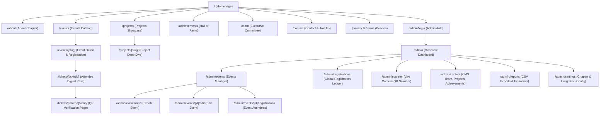

# DPGU ACM Student Chapter — Complete Sitemap & Route Matrix

## 1. Complete Site Tree Diagram



---

## 2. Complete Route Matrix

| Route Path | Page Title / Component | Access Level | Rendering Mode | SEO Indexable | Primary Data Source |
| :--- | :--- | :--- | :--- | :--- | :--- |
| `/` | Home \| DPGU ACM Student Chapter | Public | ISR / Static | Yes | Events, Stats, Highlights |
| `/about` | About Us \| DPGU ACM | Public | Static | Yes | Chapter Constitution, Timeline |
| `/events` | Events & Workshops \| DPGU ACM | Public | Dynamic SSR / ISR | Yes | `events`, `event_categories` |
| `/events/[slug]` | `[Event Title]` \| DPGU ACM | Public | Dynamic SSR | Yes | `events`, `registrations` count |
| `/tickets/[ticketId]` | Event Ticket Pass \| DPGU ACM | Public (Tokenized) | Dynamic SSR | No (`noindex`) | `tickets`, `registrations`, `events` |
| `/tickets/[ticketId]/verify` | Ticket Verification Portal | Public / Auth | Client Side | No (`noindex`) | Verification API / Token check |
| `/projects` | Student Projects \| DPGU ACM | Public | Static / ISR | Yes | `projects` |
| `/projects/[slug]` | `[Project Title]` \| Showcase | Public | Static / ISR | Yes | `projects` detail |
| `/achievements` | Hall of Fame & Awards \| DPGU ACM | Public | Static / ISR | Yes | `achievements` |
| `/team` | Executive Committee & Leads \| DPGU ACM | Public | Static / ISR | Yes | `team_members` |
| `/contact` | Contact & Join Chapter \| DPGU ACM | Public | Static | Yes | Static + Form Handler |
| `/privacy` | Privacy Policy \| DPGU ACM | Public | Static | Yes | Static Legal Markdown |
| `/terms` | Event Registration Terms \| DPGU ACM | Public | Static | Yes | Static Legal Markdown |
| `/admin/login` | Admin Portal Login \| DPGU ACM | Public | Static (Client) | No (`noindex`) | Auth Session |
| `/admin` | Executive Overview \| Admin Console | Protected (Admin) | Dynamic SSR | No (`noindex`) | Metrics, Recent Registrations |
| `/admin/events` | Manage Events \| Admin Console | Protected (Admin) | Dynamic SSR | No (`noindex`) | `events` (all statuses) |
| `/admin/events/new` | Create New Event \| Admin Console | Protected (Admin) | Dynamic SSR | No (`noindex`) | `event_categories` |
| `/admin/events/[id]/edit` | Edit Event \| Admin Console | Protected (Admin) | Dynamic SSR | No (`noindex`) | `events` by ID |
| `/admin/events/[id]/registrations` | Attendee Roster \| Admin Console | Protected (Admin) | Dynamic SSR | No (`noindex`) | `registrations` for event |
| `/admin/registrations` | All Registrations & Payments | Protected (Admin) | Dynamic SSR | No (`noindex`) | `registrations`, `payments` |
| `/admin/scanner` | In-Browser QR Attendance Scanner | Protected (Admin) | Client-Side SPA | No (`noindex`) | Camera feed, Ticket API |
| `/admin/content` | Content Management (CMS) | Protected (Admin) | Dynamic SSR | No (`noindex`) | `team_members`, `projects`, etc. |
| `/admin/reports` | Export Reports & Audit Logs | Protected (Admin) | Dynamic SSR | No (`noindex`) | Aggregated SQL views, `audit_logs` |
| `/admin/settings` | Chapter & System Settings | Protected (Admin) | Dynamic SSR | No (`noindex`) | `chapter_settings` |

---

## 3. Backend Route Handlers (`/api/*`)

| API Endpoint | HTTP Method | Auth Required | Purpose / Functionality | Rate Limit |
| :--- | :--- | :--- | :--- | :--- |
| `/api/events` | `GET` | No | List published events with query filters | 60 req/min |
| `/api/events/[slug]` | `GET` | No | Fetch single event details and seat availability | 60 req/min |
| `/api/register` | `POST` | No | Public guest registration submission (Free & Paid) | 5 req/min per IP |
| `/api/payments/create-order` | `POST` | No | Create locked gateway order (Razorpay/Cashfree) | 5 req/min per IP |
| `/api/payments/webhook` | `POST` | Webhook Sig | Asynchronous payment status verification | Provider IPs only |
| `/api/tickets/[ticketId]` | `GET` | No | Fetch public digital pass by secure UUID | 30 req/min |
| `/api/tickets/verify` | `POST` | Yes (Admin) | Validate QR code payload & mark attendee as checked-in | 120 req/min |
| `/api/contact` | `POST` | No | Handle general contact inquiries & membership forms | 3 req/min per IP |
| `/api/admin/auth/login` | `POST` | No | Verify admin credentials & issue session token | 5 req/15min |
| `/api/admin/auth/logout` | `POST` | Yes (Admin) | Invalidate admin session | Unlimited |
| `/api/admin/events` | `POST` | Yes (Admin) | Create a new event draft or published record | Admin session |
| `/api/admin/events/[id]` | `PATCH`, `DELETE` | Yes (Admin) | Update or soft-delete event | Admin session |
| `/api/admin/registrations/export` | `GET` | Yes (Admin) | Generate CSV/Excel stream of attendees | Admin session |
| `/api/admin/content/[entity]` | `POST`, `PATCH`, `DELETE` | Yes (Admin) | CMS mutations for projects, team, achievements | Admin session |

---

## 4. User Navigation & Interaction Funnels

### 4.1 Guest Event Registration Funnel (Free Event)
```
[Event Listing / Home]
       │
       ▼
[Event Detail Page: /events/hack-dpgu]
       │
       ▼ Click "Register Now (Free)"
[Registration Drawer / Modal]
  - Name, Email, Phone, College, Roll No
       │
       ▼ Validation: Capacity Check & Duplicate Email Check
[Database Transaction]
  - Inserts registration (status: CONFIRMED)
  - Generates unique ticket token & cryptographic QR code
       │
       ▼ Parallel Email Dispatch (ICS + QR Pass)
[Redirects to /tickets/DPGU-ACM-2026-X8F29A]
  - Live Digital Pass with QR
  - "Download Pass" / "Add to Google Calendar"
```

### 4.2 Guest Event Registration Funnel (Paid Event)
```
[Event Detail Page: /events/ai-robotics-workshop]
  - Fee displayed: ₹299
       │
       ▼ Click "Register & Pay ₹299"
[Registration Modal]
  - Collects guest contact details
       │
       ▼ POST /api/payments/create-order
[Database Transaction]
  - Inserts registration (status: PENDING_PAYMENT)
  - Creates locked payment gateway order
       │
       ▼ Gateway Checkout Popup (Razorpay / Cashfree)
[Attendee Completes Payment via UPI / Card]
       │
       ├── Case A: Success -> Gateway Webhook triggers POST /api/payments/webhook
       │   - Verifies HMAC-SHA256 signature
       │   - Updates registration status -> CONFIRMED
       │   - Issues ticket token & dispatches confirmation email
       │   - Client redirects to /tickets/[ticketId]
       │
       └── Case B: Failure / Abandoned
           - Registration remains PENDING or transitions to EXPIRED after 15 mins
           - User prompted with retry button
```

### 4.3 Gatekeeper / Volunteer Attendance Verification Flow
```
[Volunteer opens /admin/scanner on Mobile Browser]
       │
       ▼ Authenticated as Chapter Admin / Scanner Role
[Live Camera Viewfinder Initialized via WebRTC]
       │
       ▼ Scans Attendee QR Code
[Decodes Token & Sends POST /api/tickets/verify]
       │
       ├── Result 1: VALID FIRST-TIME SCAN
       │   - Screen flashes Emerald Green
       │   - Success Audio Tone
       │   - Displays Attendee Name, Roll No, College
       │   - Database records attendance timestamp
       │
       ├── Result 2: DUPLICATE / ALREADY USED
       │   - Screen flashes Amber / Yellow
       │   - Warning Audio Tone
       │   - Displays: "Already Checked In at 10:14 AM by Admin"
       │
       └── Result 3: INVALID TICKET
           - Screen flashes Crimson Red
           - Error Buzzer Audio
           - Displays: "Ticket token not found or counterfeit"
```
