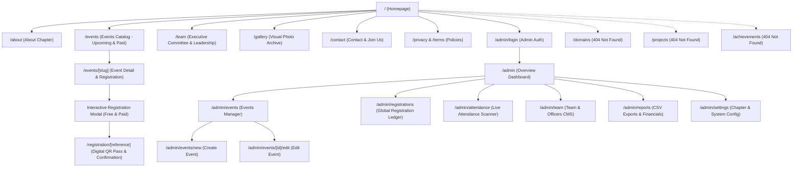

# DPGU ACM Student Chapter — Complete Sitemap & Route Matrix

## 1. Complete Site Tree Diagram

---

## 2. Complete Route Matrix

| Route Path | Page Title / Component | Access Level | Rendering Mode | SEO Indexable | Primary Data Source | Status |
| :--- | :--- | :--- | :--- | :--- | :--- | :--- |
| `/` | Home \| DPGU ACM Student Chapter | Public | ISR / Static | Yes | Leadership, Highlights, Stats | **Active (Revised)** |
| `/about` | About Chapter \| DPGU ACM | Public | Static | Yes | Chapter Constitution, Four Pillars | Active |
| `/events` | Events & Workshops \| DPGU ACM | Public | Client / SSR | Yes | `events` (Upcoming & Past Tabs) | **Active (Revised)** |
| `/events/[slug]` | `[Event Title]` \| DPGU ACM | Public | Dynamic SSR | Yes | `events`, `registrations` | Active |
| `/team` | Executive Committee & Team \| DPGU ACM | Public | Static / ISR | Yes | `team_members` (Faculty & Officers) | **Active (Updated)** |
| `/gallery` | Photo Archive \| DPGU ACM | Public | Static / ISR | Yes | `gallery_items` | Active |
| `/contact` | Contact & Chapter Membership \| DPGU ACM | Public | Static | Yes | Secretariat, Contact Form | Active |
| `/privacy` | Privacy Policy \| DPGU ACM | Public | Static | Yes | Static Legal Markdown | Active |
| `/terms` | Event Registration Terms \| DPGU ACM | Public | Static | Yes | Static Legal Markdown | Active |
| `/registration/[reference]` | Registration Confirmation \| DPGU ACM | Public (Tokenized) | Dynamic SSR | No (`noindex`) | `registrations`, `events` | Active |
| `/domains` | Obsolete Route | Public | Dynamic | No | Returns `notFound()` 404 | **Removed** |
| `/projects` | Obsolete Route | Public | Dynamic | No | Returns `notFound()` 404 | **Removed** |
| `/achievements` | Obsolete Route | Public | Dynamic | No | Returns `notFound()` 404 | **Removed** |
| `/admin/login` | Admin Portal Login \| DPGU ACM | Public | Client | No (`noindex`) | Admin Auth Session | Active |
| `/admin` | Executive Overview \| Admin Console | Protected (Admin) | Dynamic SSR | No (`noindex`) | Metrics, Recent Registrations | Active |
| `/admin/events` | Manage Events \| Admin Console | Protected (Admin) | Dynamic SSR | No (`noindex`) | `events` (all statuses) | Active |
| `/admin/events/new` | Create New Event \| Admin Console | Protected (Admin) | Client | No (`noindex`) | Event schema | Active |
| `/admin/events/[id]/edit` | Edit Event \| Admin Console | Protected (Admin) | Dynamic SSR | No (`noindex`) | `events` by ID | Active |
| `/admin/registrations` | All Registrations & Ledger | Protected (Admin) | Dynamic SSR | No (`noindex`) | `registrations`, `payments` | Active |
| `/admin/team` | Team & Officers CMS | Protected (Admin) | Dynamic SSR | No (`noindex`) | `team_members` | Active |
| `/admin/attendance` | Check-in Attendance & Telemetry | Protected (Admin) | Client | No (`noindex`) | Attendance API | Active |
| `/admin/reports` | Export Reports & Audit Logs | Protected (Admin) | Dynamic SSR | No (`noindex`) | Aggregated views, `audit_logs` | Active |
| `/admin/settings` | Chapter & System Settings | Protected (Admin) | Dynamic SSR | No (`noindex`) | `chapter_settings` | Active |

---

## 3. Public Navigation Structure

### Desktop Navigation:
- **Home** (`/`)
- **About** (`/about`)
- **Events** (`/events`)
- **Team** (`/team`)
- **Gallery** (`/gallery`)
- **Contact** (`/contact`)
- **Join Us** CTA button (`/contact`)

### Mobile Navigation Drawer:
- Complete mirrored navigation items: Home, About, Events, Team, Gallery, Contact, with primary full-width "Join Us" button.
