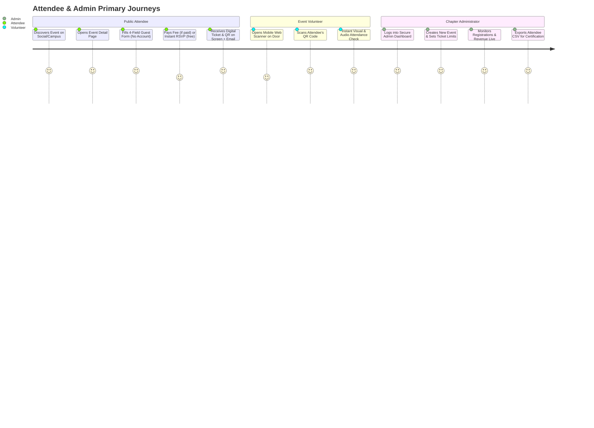
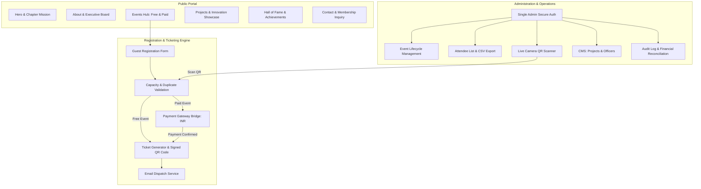

# DPGU ACM Student Chapter — Website Blueprint

## 1. Executive Summary & Vision

The **DPG University ACM Student Chapter** website serves as the central digital flagship and operational hub for the ACM Student Chapter at DPG University (Gurugram, India). 

The website addresses three strategic imperatives:
1. **Brand & Authority**: Establish an elite, technically refined online presence reflecting the standards of the Association for Computing Machinery (ACM), the world's premier computing society.
2. **Community & Showcase**: Showcase student engineering projects, chapter initiatives, hackathons, workshops, and distinguished achievements to inspire students, attract sponsors, and document chapter history.
3. **Operational Utility**: Provide an autonomous, frictionless event registration and ticketing platform capable of handling both free and paid events with zero friction (no mandatory account creation for guests), real-time capacity management, digital QR passes, and streamlined admin operations.

---

## 2. Brand Identity & Visual Aesthetic Design System

The visual design system adheres strictly to a **premium, minimal, dark-themed aesthetic**. It balances sleek tech minimalism with purposeful usability.

### 2.1 Color Palette Tokens

| Token Name | Hex Code | Role & Usage |
| :--- | :--- | :--- |
| `--bg-void` | `#05070A` | Deepest background canvas for page body |
| `--bg-surface-1` | `#0B0F17` | Primary container, section, and card background |
| `--bg-surface-2` | `#111827` | Elevated cards, dropdown menus, and modal surfaces |
| `--bg-surface-3` | `#1F2937` | Input backgrounds, interactive hover states |
| `--border-subtle` | `#1E293B` | Structural dividers and default card borders |
| `--border-accent` | `#334155` | Focused borders, active state boundaries |
| `--accent-blue` | `#0070F3` | Primary brand accent (ACM Blue derivative) |
| `--accent-cyan` | `#38BDF8` | Secondary highlight, glowing gradients, badges |
| `--accent-indigo`| `#6366F1` | Subtle secondary accent for gradient overlays |
| `--text-primary` | `#F8FAFC` | High-contrast headings and primary copy |
| `--text-secondary`| `#94A3B8` | Body copy, subtitles, metadata |
| `--text-muted` | `#64748B` | Footers, captions, timestamps, disabled items |
| `--status-success`| `#10B981` | Successful registration, valid ticket, active badge |
| `--status-warning`| `#F59E0B` | Limited tickets remaining, pending payment |
| `--status-error` | `#EF4444` | Sold out, payment failed, invalid/duplicate ticket |

### 2.2 Typography Hierarchy

- **Primary Display & Headings**: `Outfit` or `Plus Jakarta Sans` (weights 600, 700, 800) — clean geometric curves, tech-forward, high legibility.
- **Body & Interface**: `Inter` (weights 400, 500, 600) — neutral, highly legible at small sizes, optimal tabular numbers for dates and ticket counts.
- **Code, Identifiers, & Tickets**: `JetBrains Mono` or `Fira Code` (weights 400, 500) — for Registration IDs, QR payloads, transaction hashes, and event dates.

### 2.3 Visual Treatment & Micro-Interactions

- **Glassmorphism**: Soft background blur (`backdrop-blur-md` with `rgba(11, 15, 23, 0.75)`) on fixed headers, sticky navigation, and modal dialogues.
- **Gradients**: Restrained, non-distracting linear radial glow (`radial-gradient(ellipse at top, rgba(0, 112, 243, 0.12), transparent 70%)`).
- **Elevations**: Avoid heavy black drop-shadows on dark surfaces. Use 1px interior borders (`border border-slate-800/80`) paired with subtle ambient glow on hover (`hover:border-blue-500/40 hover:shadow-[0_0_20px_rgba(0,112,243,0.15)]`).
- **Animations**: Subtle, spring-physics micro-interactions (Framer Motion / CSS hardware-accelerated transforms):
  - Page entry: Soft fade-in and upward slide (15px delta, 300ms ease-out).
  - Cards: Scale `1.015` on desktop hover with border illumination.
  - Interactive triggers: Smooth active press feedback (`scale-98`).

---

## 3. Target Personas & User Journey Maps

### 3.1 Persona Profiles

1. **The Prospective / Current Student Attendee**:
   - *Goal*: Discover tech talks, workshops, hackathons; register in under 60 seconds without creating an account or remembering another password.
   - *Pain Point*: Mandatory registration account creation, buggy payment flows, lost ticket links.
   - *Solution*: Frictionless 1-step guest form, automatic ticket screen with instant download, copy link, and automated email confirmation.

2. **The Chapter Officer / Event Lead**:
   - *Goal*: Publish new events, monitor real-time registration counts, prevent overbooking, check payment statuses.
   - *Pain Point*: Manual Google Forms, tracking manual UPI screenshots, reconciling registrations with bank statements.
   - *Solution*: Centralized dashboard with automated payment gateway verification, real-time quota counters, and 1-click CSV export.

3. **The Event Volunteer / Gatekeeper**:
   - *Goal*: Quickly verify ticket holders at the venue auditorium door on mobile without downloading special apps.
   - *Pain Point*: Slow manual cross-checking of paper lists or PDF spreadsheets causing entrance bottlenecks.
   - *Solution*: In-browser camera QR code scanner with instant real-time verification (Green = Valid, Yellow = Already Checked In, Red = Invalid).

---

## 4. Functional Modules & Capabilities

### 4.1 Module Breakdown

#### Module 1: Chapter Showcase (Public Portal)
- **Home / Landing**: Visual hero with chapter identity, upcoming spotlight event banner, live counter of events held/members, core pillars (Learn, Build, Network, Lead).
- **About Us**: Affiliation with ACM International, chapter constitution highlights, faculty advisor message, chapter timeline.
- **Executive Team**: Filterable roster of current and past officers (Chair, Vice-Chair, Secretary, Treasurer, Tech Leads, Design Leads, Webmasters) with LinkedIn/GitHub links.
- **Projects Showcase**: Curated directory of student-built open-source projects, hackathon winners, and research initiatives with live demos and repository links.
- **Achievements & Hall of Fame**: Competitions won (ICPC, SIH, regional hackathons), research papers published, and alumni milestones.
- **Contact & Community**: Direct contact form, Discord/WhatsApp community links, FAQ, and campus chapter membership application form.

#### Module 2: Event Discovery & Guest Registration Engine
- **Event Filter & Status**: Filter by `All`, `Upcoming`, `Past`, `Workshops`, `Hackathons`, `Webinars`.
- **Event Details**: Date, time, venue (or online link), speaker profiles, agenda, prerequisites, capacity bar (`X of Y spots filled`), ticket fee (`Free` or `₹XXX`).
- **Frictionless Registration Flow**:
  - Name, Email, Phone Number, College/Institution, Department/Roll Number.
  - Zero password or account creation required.
  - Duplicate registration protection: Immediate check prevents duplicate registrations for the same email address per event.
  - Sold-out state: Form automatically disables when capacity limit is reached.

#### Module 3: Payment Gateway & Verification Pipeline
- Supported payment channels: UPI, Credit/Debit Cards, NetBanking via Indian payment gateway (Razorpay / Cashfree / Stripe India).
- Client requests payment order -> Backend creates order with locked amount -> Attendee completes payment -> Webhook listener verifies cryptographic signature (`HMAC-SHA256`) -> Registration marked `CONFIRMED` -> Ticket issued.
- Built-in failure recovery: If user drops off or payment fails, registration is tagged `FAILED` with retry option before expiration.

#### Module 4: Digital Pass & Ticketing Pipeline
- **Unique Ticket Token**: Secure cryptographic identifier (`DPGU-ACM-[YEAR]-[UUID8]`).
- **Ticket QR Code**: Encodes signed verification URL and ticket token for rapid in-browser validation.
- **Ticket Presentation**: Clean, printable digital boarding-pass style card with "Add to Calendar", "Download Pass (PNG/PDF)", and "Print Ticket".
- **Email Delivery**: Automated transactional email sent via SMTP/Resend containing event details, calendar `.ics` invite, and embedded QR pass.

#### Module 5: Admin Operations & QR Attendance Scanner
- **Single Admin Authentication**: Secure credentials-based authentication with session management and optional two-factor authentication (TOTP).
- **Event Management**: Create, edit, publish, draft, cancel, and archive events with custom form questions and ticket pricing.
- **Attendee Directory**: Searchable, filterable registration table with status filters (`Confirmed`, `Pending`, `Attended`, `Cancelled`), manual check-in toggle, and CSV export.
- **In-Browser QR Scanner**: PWA-ready camera scanner utilizing device back camera; instant audio tone and visual green/red feedback for gate volunteers.
- **Content CMS**: Manage executive committee members, featured projects, and achievements without code edits.

---

## 5. Non-Functional Requirements (NFRs)

### 5.1 Performance & Reliability
- **Lighthouse Goals**: Score $\ge 90$ across Performance, Accessibility, Best Practices, and SEO.
- **First Contentful Paint (FCP)**: $< 1.2$ seconds on desktop, $< 2.0$ seconds on 4G mobile.
- **Time to Interactive (TTI)**: $< 2.5$ seconds.
- **Optimized Asset Delivery**: WebP/AVIF format for all images, responsive `<Image />` tags, font preloading, tree-shaken Lucide icons.

### 5.2 Security & Data Protection
- **No Account Credential Leakage**: Guests never store passwords; risk of credential stuffing for attendees is eliminated.
- **Payment Verification**: Webhook signatures strictly verified against server secret. Never trust frontend payment callback status alone.
- **SQL & Injection Defense**: Parameterized queries enforced via Supabase PostgREST client and Prisma/Kysely ORM.
- **Rate Limiting**: IP-based rate limiting on registration submissions and admin login attempts to prevent automated spam and brute-force attacks.
- **CSRF & Security Headers**: Strict Content-Security-Policy (CSP), `X-Frame-Options: DENY`, `X-Content-Type-Options: nosniff`, `Strict-Transport-Security`.

### 5.3 Privacy & Data Governance
- Strict data minimization: Only collect fields required for event admission and university chapter records.
- No commercial tracking cookies or third-party ad pixels.
- Compliance with the Digital Personal Data Protection Act (DPDP Act, India).

### 5.4 Accessibility (a11y)
- Full compliance with **WCAG 2.1 Level AA**.
- High contrast ratios ($\ge 4.5:1$ for normal text against dark backgrounds).
- Focus outlines visible for keyboard navigation.
- Accessible ARIA labels on all modal dialogs, icon buttons, and form inputs.
